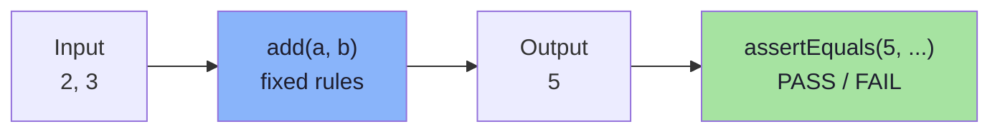
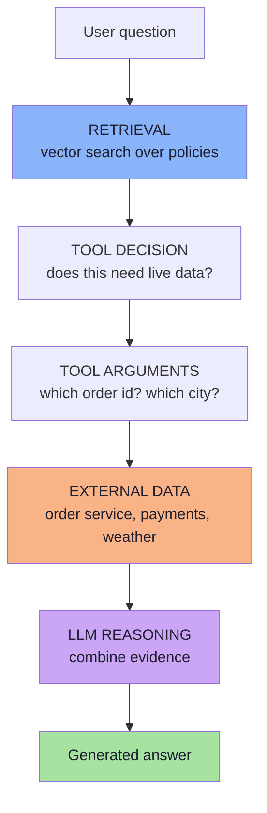
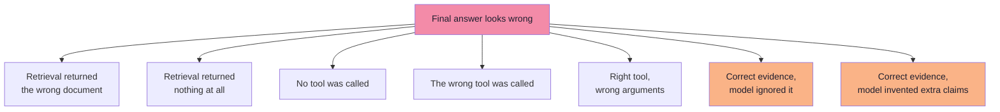
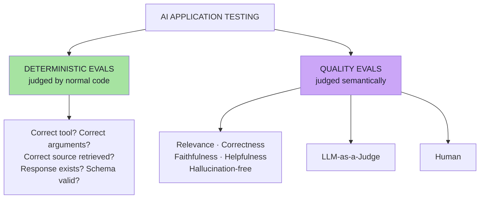
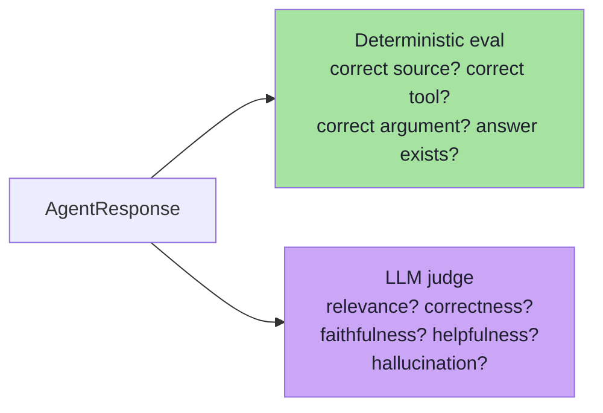
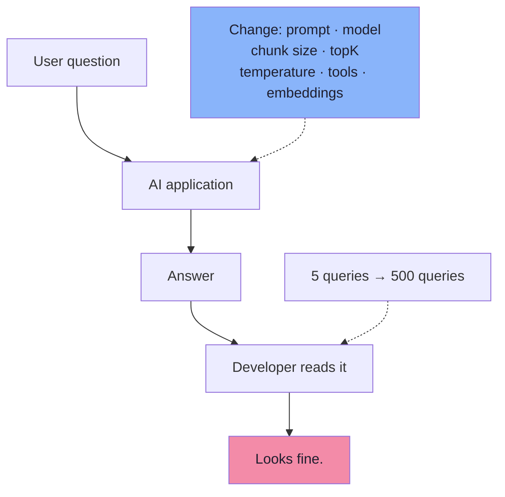
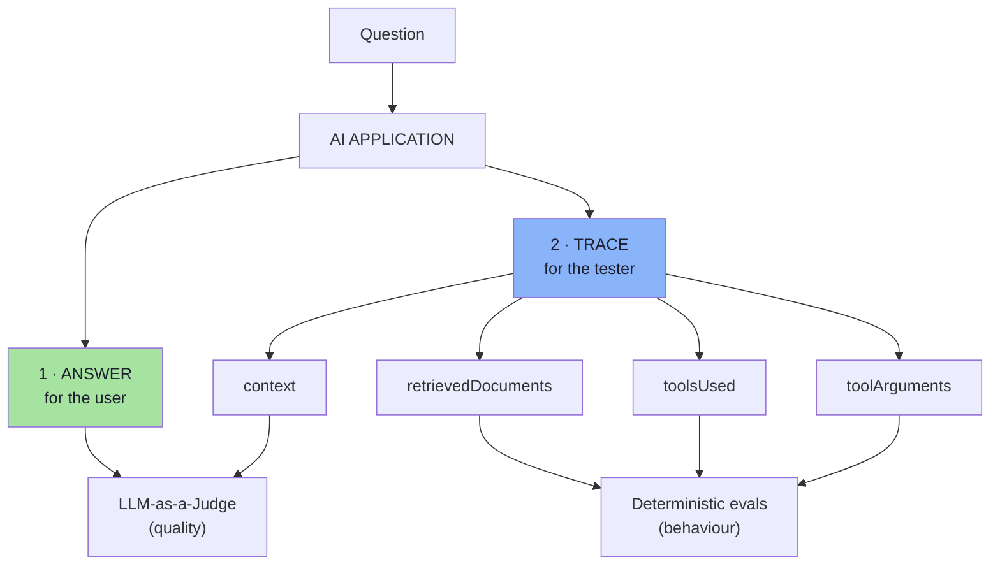

# Chapter 01: Why AI Application Testing Is Different

> **Chapter Goal:** Traditional software is testable because it is **deterministic** — the same input always produces the same output, so `Expected Output == Actual Output` is a legitimate assertion. An AI application is not that. It is a **pipeline** of retrieval, tool selection, tool arguments, external data and model reasoning, and *any* stage can be the reason the final answer is wrong.
>
> This chapter establishes the problem that the rest of the lecture solves: **testing only the final answer tells you that something failed, never what failed.**
>
> At the end of this chapter you should be able to answer: *my support agent gave a wrong answer — was it retrieval, the tool call, the tool arguments, the context, or the generation?*

---

## 1.1 The Assumption Traditional Testing Rests On

Traditional software testing is straightforward because the code behaves like a mathematical function:

```text
Same Input  →  Same Logic  →  Same Output        (every time)
```

```text
int add(int a, int b) {
    return a + b;
}
```

Input `2, 3` → expected output `5` → so we write:

```text
assertEquals(5, add(2, 3));
```

That assertion is only possible because two properties hold at once:

| Property | Meaning | What it enables |
|---|---|---|
| **Determinism** | The same input always produces the same output | A single expected value can be written down |
| **Exactness** | There is exactly one correct output | A `==` comparison can decide pass / fail |



> **Hold on to this.** Every problem in this lecture is a consequence of losing *determinism*, *exactness*, or both.

---

## 1.2 What an AI Application Is Actually Made Of

An AI application is not one model call. A realistic one involves:

```text
LLM reasoning
RAG (retrieval-augmented generation)
Tool calling
External data
Non-deterministic model responses
```



Every box is a **failure point**. Every box is also a **thing you can measure**.

| Stage | Deterministic? | Why it can fail |
|---|---|---|
| Retrieval | Partly — *which* documents came back is a fact | Wrong chunking, wrong `topK`, embedding drift, stale index |
| Tool decision | Yes — *which* tool was called is a fact | Model picks the wrong tool, or picks none |
| Tool arguments | Yes — *which* arguments were passed is a fact | Right tool, wrong order id |
| External data | No — data changes under you | Downstream service changed the record |
| LLM reasoning | No — sampling varies | Misread evidence, ignored context |
| Final answer | No — many phrasings are correct | Everything above, plus hallucination |

> **Key insight:** the stages that are *hard to judge* are at the end; the stages that are *easy to judge* are in the middle. Most teams only test the end.

---

## 1.3 So Testing Only the Final Output Is Not Enough

Because the pipeline has many stages, a single wrong answer has many possible causes. If we only look at the output, we cannot tell them apart.

Consider what we actually want to know:

```text
Did the correct document get retrieved?
Did the model call the correct tool?
Were the correct arguments passed?
Was the answer grounded in the available evidence?
Did the model hallucinate?
Was the answer actually useful?
```



Each branch has a **different fix**. Fixing branch 1 is a chunking or embedding problem. Fixing branch 5 is a prompt or schema problem. Fixing branch 7 is a grounding/faithfulness problem. A single number — *"the answer was wrong"* — collapses seven distinct engineering tasks into one useless signal.

> **The question this lecture answers:** *how do we systematically measure the behaviour of a probabilistic application, stage by stage, in a way that is repeatable?*

---

## 1.4 The Seven Questions That Replace "Is the Answer Good?"

Instead of one vague question, evaluation asks a set of **specific, answerable** questions:

```text
Did the correct document get retrieved?
Did the model call the correct tool?
Were the correct arguments passed?
Was the answer grounded in the available evidence?
Did the model hallucinate?
Was the answer actually useful?
```

| Question | Type of answer | Who can judge it |
|---|---|---|
| Correct document retrieved? | Yes / No (a set comparison) | **Code** |
| Correct tool called? | Yes / No (a name comparison) | **Code** |
| Correct arguments passed? | Yes / No (a value comparison) | **Code** |
| Answer grounded in evidence? | Semantic judgement | **LLM judge / human** |
| Hallucination present? | Semantic judgement | **LLM judge / human** |
| Answer useful? | Semantic judgement | **LLM judge / human** |
| Answer relevant / correct? | Semantic judgement | **LLM judge / human** |

> **Notice the split.** Roughly half of the questions about an AI system are *not* semantic at all — they are ordinary software assertions about the system's own execution. That observation is the central thesis of the lecture.

---

## 1.5 The Two Families of Evaluation

Every AI evaluation you will ever write belongs to one of two families.



| Family | Decided by | Output | Cost | Variance |
|---|---|---|---|---|
| **Deterministic eval** | Normal code | `PASS` / `FAIL` (exact) | ~0 | None |
| **Quality eval** | LLM judge or human | A score, e.g. 1–5 | Tokens + latency | Real |



The two families are **not alternatives**. A serious system runs both, because they catch disjoint classes of defect:

| Defect class | Caught by | Missed by |
|---|---|---|
| Retrieval returned nothing | Deterministic | Judge (it never sees the retrieval step) |
| Wrong tool / wrong order id | Deterministic | Judge (the answer may still *sound* fine) |
| Right evidence, answer ungrounded | LLM judge | Deterministic (nothing to compare exactly) |
| Right everything, answer rude or unclear | LLM judge | Deterministic |

---

## 1.6 Where the Non-Determinism Actually Comes From *(beyond the lecture)*

The lecture says AI responses are non-deterministic. For engineering purposes it helps to know **exactly which levers move**, because most of them can be pinned.

| Source of variation | Effect | Practical mitigation |
|---|---|---|
| `temperature` / `top_p` sampling | Different wording, occasionally different facts | Use temperature `0` for eval runs; accept residual variance |
| No fixed `seed` | Re-running gives a different sample | Set `seed` where the provider supports it |
| **Provider model updates** | Silent behaviour change with no code change | Pin explicit model versions; re-run the dataset on upgrade |
| Prompt rewording | Large behavioural shifts | Version prompts; treat a prompt as a deployable artefact |
| **Retrieval index rebuild** | Chunk ids, embeddings, `topK` ordering change | Snapshot the index for eval runs; re-embed deliberately |
| Context ordering / truncation | Same documents, different order → different answer | Freeze the assembly order; assert on it |
| **Live external data** | `getOrderStatus` returns a different value tomorrow | Use fixture order ids in the golden dataset |
| Tool availability / timeouts | Fallback path taken | Record `error` in the trace; test the fallback separately |
| Concurrency / streaming chunking | Truncated or re-ordered output | Assert on the completed response, not partials |

> **Design rule:** *non-determinism is a spectrum, not a binary.* Your job is to reduce it to the minimum your product tolerates, then measure the behaviour that remains — not to declare the system untestable.

### 1.6.1 The consequence for test design

Because some variance is irreducible, an AI test suite is judged **statistically**, not per-run:

```text
Traditional:  the suite passes when every assertion passes
AI:           the suite passes when the aggregate score is above threshold
              and no previously-passing case regressed
```

Chapter 07 turns that sentence into an actual pipeline; Chapter 08 turns it into a release gate.

---

## 1.7 Why "Looks Good to Me" Does Not Scale

The most common evaluation method in practice is: run a few questions, read the answers, decide they look fine.



Three things are wrong with it:

| Problem | Consequence |
|---|---|
| No fixed input set | You test different questions each time; nothing is comparable |
| No baseline | You cannot tell whether this version is better or worse than the last |
| No repeatability | The next person cannot reproduce your judgement |

And the volume problem is fatal:

```text
5 queries      → a human can read them
500 queries    → a human cannot
500 queries × every prompt change × every model change × every PR
```

### 1.7.1 The regression that motivates everything

```text
topK 5 → 3        latency improves ✅        cost drops ✅
the document that ranked #4 is never retrieved ❌
that question is now answered without its evidence ❌
→ SILENT REGRESSION: no crash, no error, no alert, no stack trace
```

> **This is the class of bug that AI evals exist to catch.** Nothing throws. The API returns `200 OK` with a fluent, confident, *wrong* answer. Only a fixed dataset that asserts *"the expected document must be retrieved"* catches it — and it catches it **before the customer does**.

---

## 1.8 The Cost of Not Having Evals

| Symptom you observe | The real, unmeasured cause |
|---|---|
| "The model got worse last week" | A prompt or model-version change nobody benchmarked |
| "It answers confidently but wrongly" | No faithfulness metric, no grounding check |
| "It stopped finding the policy document" | `topK` / chunking change; no retrieval assertion |
| "It calls the wrong tool sometimes" | No tool-selection assertion; the error is invisible |
| "We can't ship the prompt fix" | No dataset to prove the fix is a fix |
| "Every release is a gamble" | No baseline, no gate, no regression diff |

> **Framing:** evals are not a dashboard. They are the **regression-testing layer** of an AI application — the thing that lets you change a prompt on a Tuesday without gambling the product.

---

## 1.9 Mental Model: Every Request Produces Two Outputs



> **The answer is for the user. The trace is for you.** Chapter 03 builds the trace; Chapters 05–07 consume it.

---

## 1.10 Common Mistakes at This Stage

| Mistake | Why it hurts | Correct habit |
|---|---|---|
| Testing only the final answer | Cannot attribute the failure to a stage | Record and assert on the trace |
| Assuming non-determinism makes testing impossible | It only makes *exact-output* testing impossible | Pin what you can; measure behaviour and aggregates |
| Asking an LLM whether the right tool was called | Wasteful and less reliable than `==` | Use code (Chapter 05) |
| Treating "the LLM hallucinates" as the defect | It is a symptom of one stage, not a measurable defect | Name the stage and the metric |
| Designing an agent whose internals are invisible | Nothing is testable | Design for observability (Chapter 03) |
| Judging quality by reading a handful of outputs | No baseline, no repeatability | Fixed dataset + scores (Chapters 04–06) |
| Changing the prompt with no eval run | Silent regression reaches production | Every change re-runs the dataset |

---

## 1.11 Chapter Summary

| Idea | Statement |
|---|---|
| Why normal testing works | Software is **deterministic** and **exact**: same input → same output |
| Why AI breaks it | LLM reasoning, RAG, tools, external data and sampling all vary |
| The real problem | *How do we systematically measure the behaviour of a probabilistic application?* |
| The structural insight | An AI application is a **pipeline**, not a function |
| The attribution problem | One wrong answer has many possible causes; the trace separates them |
| The replacement questions | Correct document? Correct tool? Correct arguments? Grounded? Hallucinated? Useful? |
| The two families | **Deterministic evals** (code) + **Quality evals** (LLM judge / human) |
| The core rule | If code can decide it, code decides it |
| The anti-pattern | "Looks good to me" — an opinion with no baseline |
| What evals are | The regression-testing layer of an AI application |

> **Final mental model for this chapter:** traditional software engineering asks *"does the code produce the expected result?"* AI engineering asks *"does the system consistently exhibit the behaviour and quality we expect?"* — and the only way to answer the second question is to **make the behaviour observable and then measure it twice: once with code, once with judgement.**

---

## Where This Goes Next

- **[Chapter 02](./02_The_Application_Under_Test.md)** — the application under test: the three question categories, and why each creates separately testable behaviour.
- **[Chapter 03](./03_Observability_AgentResponse_And_Traces.md)** — `AgentResponse` and the eval trace: the data layer that makes attribution possible.
- Cross-lecture: [Lecture 05](../../Lecture%2005/notes/README.md) (agents, tool calling, failure modes), [Lecture 11](../../Lecture%2011/notes/README.md) / [Lecture 12](../../Lecture%2012/notes/README.md) (RAG: chunking, retrieval, reranking — the levers behind the regression example), [Lecture 13](../../Lecture%2013/notes/README.md) (structured outputs — the contract that doubles as a test), [Lecture 17](../../Lecture%2017/notes/README.md) (the general theory of GenAI evals this lecture applies).

---

**Back to:** [Lecture 18 — Chapter Index](./README.md) · [Complete Consolidated Notes](./Lecture_18_Complete_Notes.md)


