# Chapter 02: The Application Under Test — An E-commerce Support Agent

> **Chapter Goal:** You cannot design an evaluation strategy without knowing exactly which behaviours your system has. This chapter builds the application the whole lecture evaluates: a small **e-commerce support agent** that answers three *kinds* of questions — knowledge-based (RAG), order-specific (tools), and questions that need both.
>
> The three categories matter because each one creates a **different, separately testable behaviour**. A RAG question creates retrieval behaviour and generation behaviour. A tool question creates tool-selection behaviour and tool-argument behaviour. A combined question creates all four plus reasoning over two evidence sources.
>
> At the end of this chapter you should be able to answer: *for any question my agent receives, which internal behaviours should I be able to check?*

---

## 2.1 Why We Need a Realistic Application

A trivial application cannot demonstrate evaluation. If the system is:

```text
User  →  LLM  →  Answer
```

then the only things you can evaluate are the properties of the answer itself — **relevance**, **correctness**, **helpfulness** — and there is *no internal behaviour to inspect*.

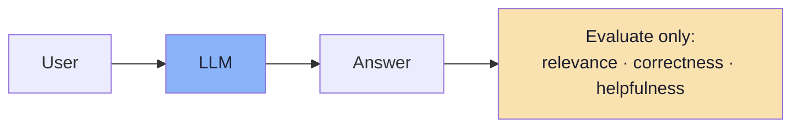

That is a weak demonstration of AI evaluation, because the interesting part of an AI system — *retrieval, tool selection, argument passing, grounding* — is missing.

So the lecture builds an application with real internal structure:

> **An E-commerce Support Agent** that answers three kinds of questions.

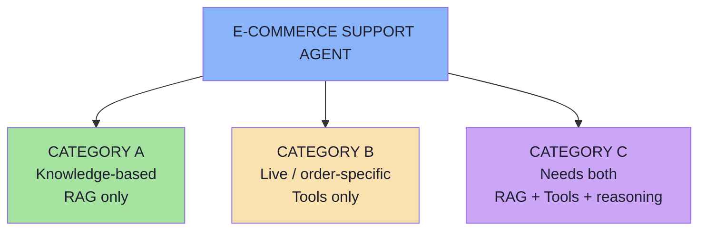

---

## 2.2 Category A — Knowledge-Based Questions

**Example question:**

```text
How many days do I have to return a product?
```

The answer exists inside company documents. For example, the return policy:

```text
Return Policy
Products can be returned within 30 days of delivery.
```

> **The LLM should not be expected to know our company's private policies.** A general-purpose model has never seen your internal handbook, and it never will. Instead, the application retrieves the information using **RAG**.

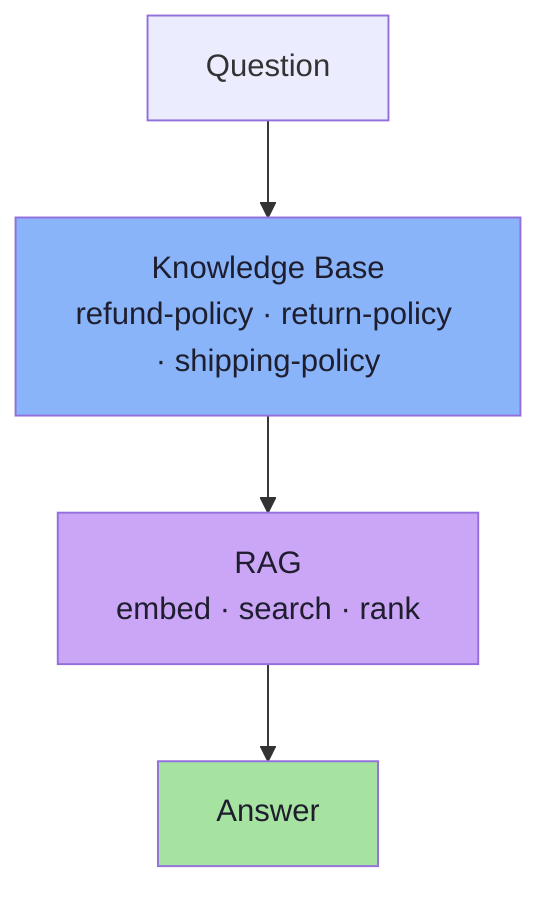

### 2.2.1 This Creates Two Separate Things to Evaluate

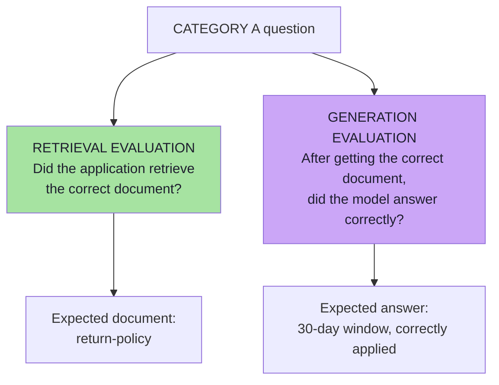

| Evaluation | Question | Judged by |
|---|---|---|
| **Retrieval evaluation** | Did the correct document get retrieved? (`return-policy`) | Code — it is a set comparison |
| **Generation evaluation** | Given the correct document, was the answer correct? | Semantics — an LLM judge or a human |

**These are two different failure points.** A wrong answer could mean:

```text
Wrong document retrieved
```

or:

```text
Correct document retrieved
but the LLM generated a bad answer
```

> This distinction is **extremely useful while debugging AI applications** — and it is the whole reason Chapter 03 insists on recording `retrievedDocuments`.

---

## 2.3 Category B — Live / Order-Specific Questions

**Example question:**

```text
Where is ORD-101?
```

This information cannot realistically come from policy documents. A policy document might say:

```text
Orders usually arrive within 3–5 business days.
```

But it cannot tell us:

```text
ORD-101 is currently shipped.
```

That is **dynamic, application-specific** information. For this, we need a **tool**.

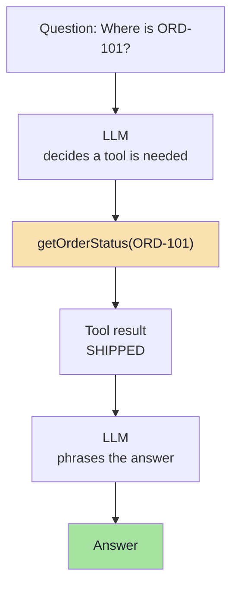

### 2.3.1 This Creates Two More Things to Evaluate

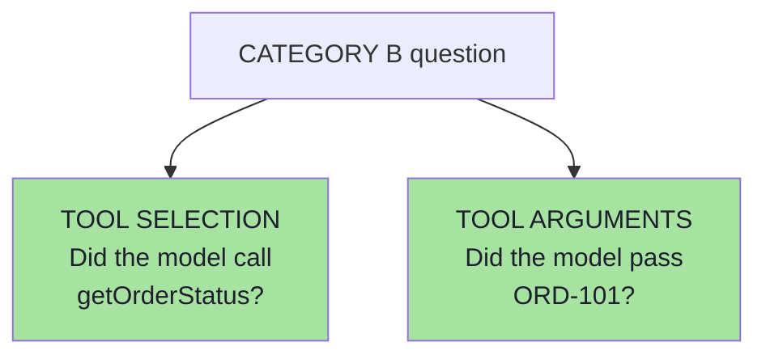

| Evaluation | Question | Judged by |
|---|---|---|
| **Tool selection** | Did the model call `getOrderStatus`? | Code — string comparison on the tool name |
| **Tool arguments** | Did the model pass `ORD-101`? | Code — comparison on the argument payload |

> **Both are deterministic checks.** There is nothing semantic about them. This is the single most important structural fact in the lecture: *the two behaviours people most often ask an LLM judge about are the two behaviours code can decide perfectly.*

---

## 2.4 Category C — Questions That Need Both (RAG + Tools + Reasoning)

**Example question:**

```text
My order ORD-102 was delivered 20 days ago.
Can I still return it?
```

The application needs **two different pieces of information**, from two different sources.

### Information 1 — Company Policy

The return policy comes from **RAG**:

```text
Products may be returned within 30 days of delivery.
```

### Information 2 — Order Information

The actual order information comes from a **tool**:

```text
ORD-102
Status: Delivered
Delivered: 20 days ago
```

### The Reasoning Step

The model then combines both pieces of information:

```text
20 days  <  30-day return window      →  TRUE
```

and answers:

```text
Yes. Your order is still within the 30-day return window.
```

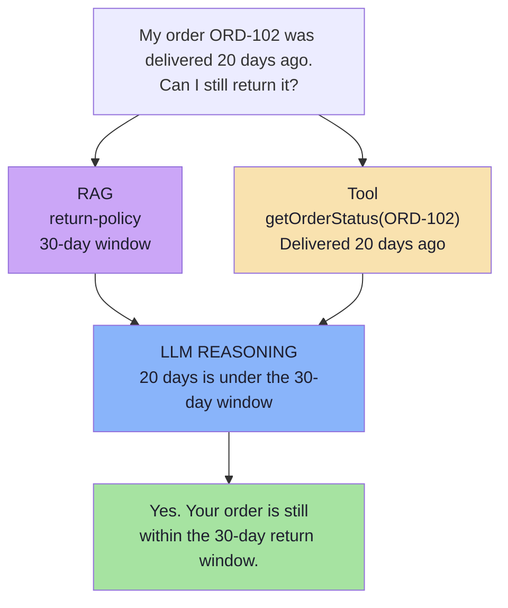

Now the application genuinely involves:

```text
RAG
+
Tools
+
LLM Reasoning
```

> **This makes it a good application for understanding AI evaluations** — because it contains every failure mode at once, and a wrong final answer could have come from any of the three.

### 2.4.1 The Two Evidence Sources Must Not Be Confused

Category C is where **attribution** earns its keep:

| Possible failure | Stage | Fix |
|---|---|---|
| Retrieved `shipping-policy` instead of `return-policy` | Retrieval | Chunking, embeddings, `topK`, reranking |
| Never called `getOrderStatus` | Tool selection | Tool descriptions, prompt, tool-choice mode |
| Called `getOrderStatus("ORD-101")` | Tool arguments | Argument schema, prompt, entity extraction |
| Got `20 days` and `30 days` but answered "No" | Reasoning / generation | Prompt, few-shot examples, model choice |
| Answered "Yes" but invented "you also get free shipping" | Grounding | Faithfulness rubric, stricter grounding instruction |

Five different bugs, five different fixes, **one identical symptom** at the API boundary.

---

## 2.5 Why Not Just Test a Simple Chatbot?

Suppose our application was only:

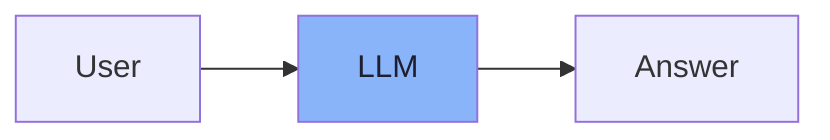

We could evaluate things such as **relevance**, **correctness** and **helpfulness** — but **there would not be much internal behaviour to inspect**.

By contrast, our support agent gives us **many observable behaviours**:

```text
Did retrieval happen correctly?
Did the correct document come back?
Did the correct tool get called?
Were the tool arguments correct?
Was the final answer relevant?
Was the answer correct?
Was it grounded?
Did the model hallucinate?
```

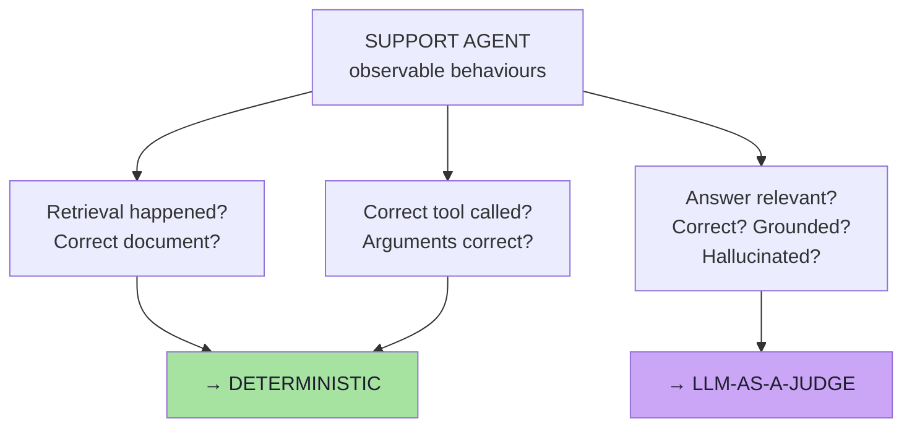

This gives us **two major categories of evaluation**:

```text
Deterministic Evals
+
LLM-as-a-Judge
```

> **Design lesson:** the *shape of your evaluation* is decided by the *shape of your architecture*. A single-shot chatbot can only be judged on quality; a RAG + tool agent can be judged on behaviour too. If you want cheap, reliable tests, build a system whose behaviour is observable.

---

## 2.6 The Three Tools

The lecture keeps the tools very small — deliberately, so the *evaluation* is the subject, not the tool implementation.

### Tool 1 — Order Status

```text
getOrderStatus(orderId)
```

Example:

```text
getOrderStatus("ORD-101")     →  SHIPPED
```

### Tool 2 — Delivery Estimate

```text
getDeliveryEstimate(orderId)
```

Example:

```text
getDeliveryEstimate("ORD-101")  →  Expected delivery: 15 October 2026
```

### Tool 3 — Refund Amount

```text
getRefundAmount(orderId)
```

Example:

```text
getRefundAmount("ORD-103")      →  ₹4,999
```

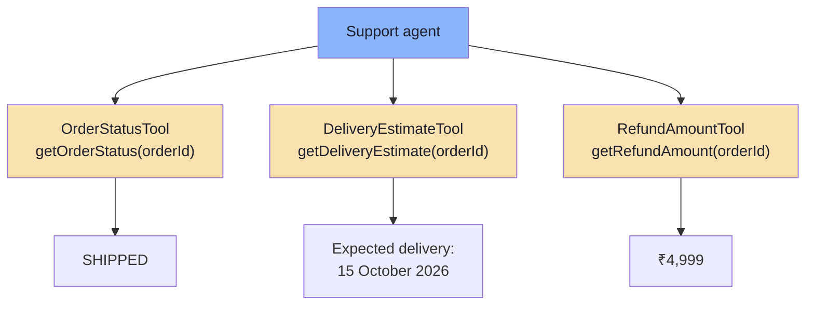

### 2.6.1 Why Three Tools Matter More Than One

With a single tool, "did the model call the right tool?" is almost always `true` — the test is vacuous. With **three** tools, tool selection becomes a **real classification problem** with real confusion cases:

| Question | Correct tool | Plausible wrong choice |
|---|---|---|
| "Where is ORD-101?" | `getOrderStatus` | `getDeliveryEstimate` |
| "When will ORD-101 arrive?" | `getDeliveryEstimate` | `getOrderStatus` |
| "How much will I get back for ORD-103?" | `getRefundAmount` | `getOrderStatus` |

> **Eval-design rule:** a test suite only detects a class of error if the system *can* make that error. Design the system so confusable options exist, then measure whether the model confuses them.

---

## 2.7 The Application Architecture

At the application level:

```text
USER
 │
 ▼
POST /chat
 │
 ▼
SupportController
 │
 ▼
SupportService
 │
 ▼
ChatClient
```

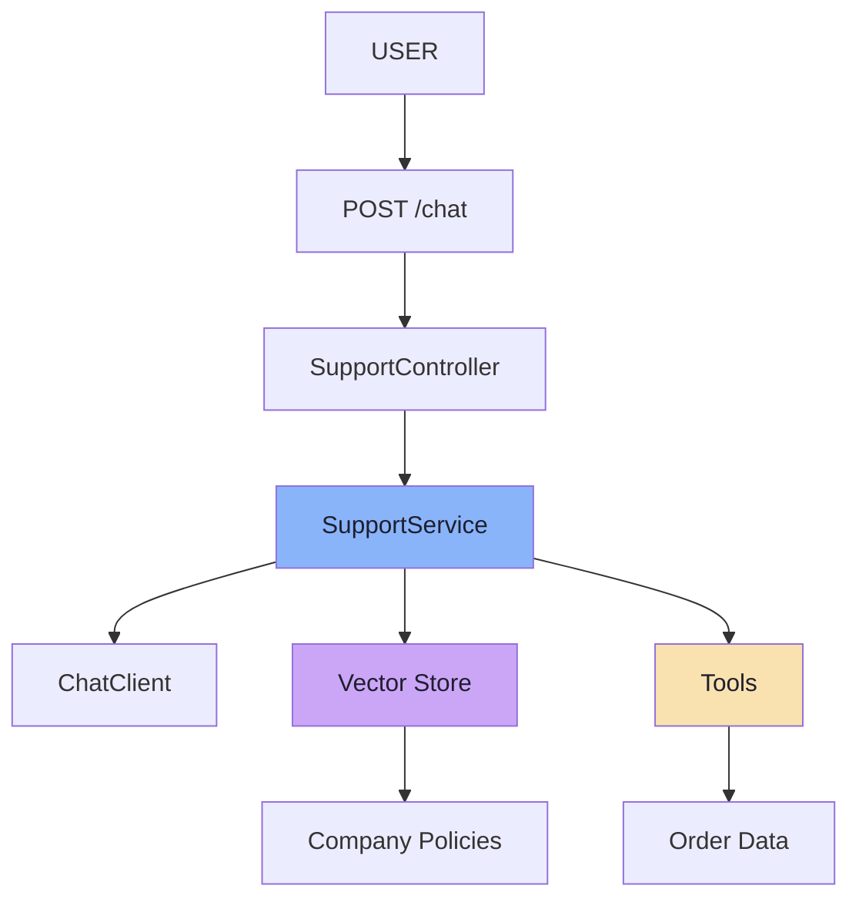

The `SupportService` can access **two major external information sources**:

| Source | Backing store | Serves | Category |
|---|---|---|---|
| **Vector store** | In-memory / vector DB | Company policies (`return-policy`, `refund-policy`, `shipping-policy`) | A, C |
| **Tools** | Order data | Live order status, delivery estimate, refund amount | B, C |

> **The LLM can use either source depending on the question** — and, critically, *the choice of source is itself a behaviour you can evaluate.*

### 2.7.1 The Final Application Architecture

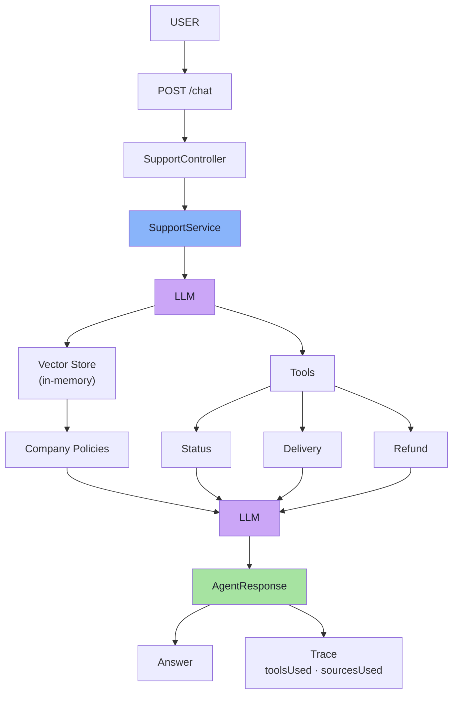

Note the two things this diagram proves:

1. **There is a decision point** (`LLM` choosing vector store vs tools) — a behaviour worth testing.
2. **The response splits into `Answer` and `Trace`** — the subject of Chapter 03.

---

## 2.8 The Three-Category Test Matrix

Putting the whole chapter together gives the single most useful table in the lecture — **what to test for each category of question**:

| | Category A (RAG) | Category B (Tools) | Category C (Both) |
|---|---|---|---|
| **Example** | "How many days do I have to return a product?" | "Where is ORD-101?" | "ORD-102 was delivered 20 days ago — can I still return it?" |
| **Evidence source** | Vector store | Order service | Vector store **+** order service |
| **Retrieval eval** | ✅ required | ➖ must be empty | ✅ required |
| **Tool-selection eval** | ➖ must be empty | ✅ required | ✅ required |
| **Tool-argument eval** | ➖ n/a | ✅ required | ✅ required |
| **Reasoning eval** | ❌ not needed | ❌ not needed | ✅ required |
| **Quality eval (judge)** | ✅ relevance, correctness, faithfulness | ✅ relevance, correctness, faithfulness | ✅ all five metrics |

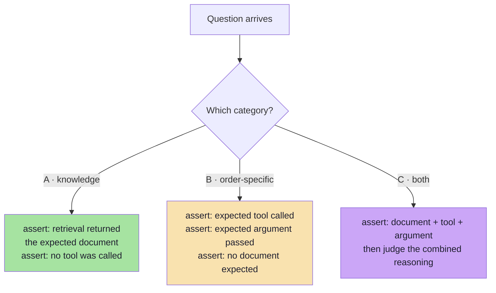

> **The `➖ must be empty` column is the part teams forget.** Asserting that the agent did *not* call a tool on a policy question is a real test — it catches over-eager tool use, which wastes money and can leak order data into unrelated answers.

---

## 2.9 Chapter Summary

| Idea | Statement |
|---|---|
| The application | A small **e-commerce support agent** answering three categories of question |
| Category A | Knowledge-based → answered by **RAG** from company policies |
| Category A yields | **Retrieval** evaluation + **generation** evaluation (two different failure points) |
| Category B | Live / order-specific → answered by **tools** from order data |
| Category B yields | **Tool selection** + **tool arguments** (both deterministic) |
| Category C | Needs **RAG + tools + reasoning** → every failure mode in one request |
| The three tools | `getOrderStatus`, `getDeliveryEstimate`, `getRefundAmount` |
| Why three tools | Tool selection only becomes a real test when confusable alternatives exist |
| The architecture | `USER → POST /chat → SupportController → SupportService → ChatClient` |
| Two sources | **Vector store** (policies) and **tools** (order data) |
| The design lesson | The shape of your evaluation is decided by the shape of your architecture |

> **Final mental model for this chapter:** every question type in your product creates a *contract* — "this question must be answered from this evidence, using this tool, with these arguments." Write those contracts down; Chapter 04 turns them into a golden dataset and Chapters 05–06 turn them into checks.

---

## Where This Goes Next

- **[Chapter 03](./03_Observability_AgentResponse_And_Traces.md)** — how to expose the internal behaviour these categories require (`AgentResponse`, `retrievedDocuments`, `toolsUsed`, `toolArguments`, `context`).
- **[Chapter 04](./04_The_Golden_Dataset.md)** — encoding each category's expected behaviour as a test case.
- Cross-lecture: [Lecture 05](../../Lecture%2005/notes/README.md) (agents and tool calling), [Lecture 11](../../Lecture%2011/notes/README.md) / [Lecture 12](../../Lecture%2012/notes/README.md) (RAG pipeline internals), [Lecture 14](../../Lecture%2014/notes/README.md) / [Lecture 15](../../Lecture%2015/notes/README.md) (tool/resource contracts in MCP).

---

**Back to:** [Lecture 18 — Chapter Index](./README.md) · [Complete Consolidated Notes](./Lecture_18_Complete_Notes.md)


