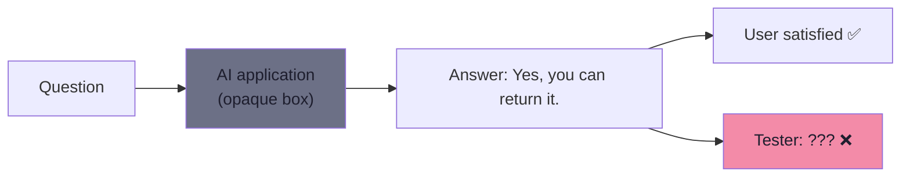
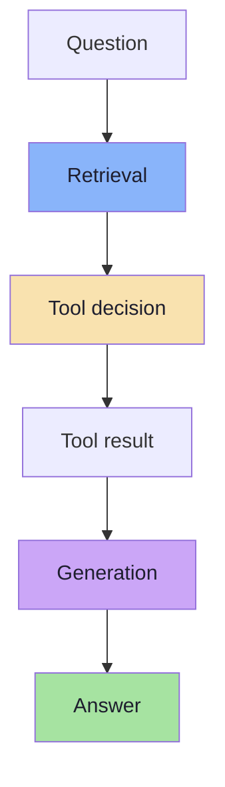
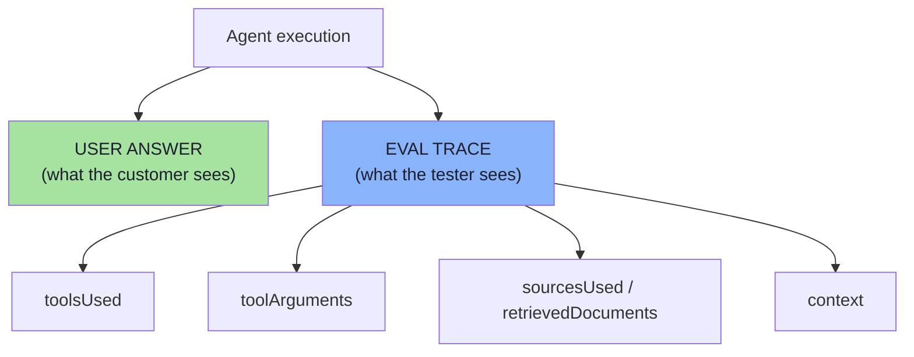
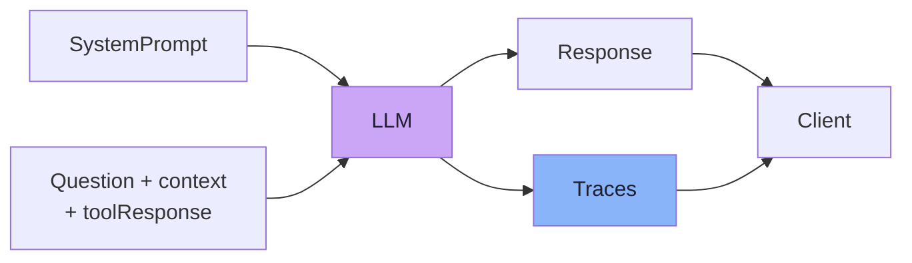
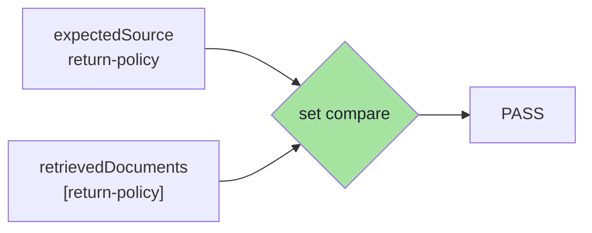
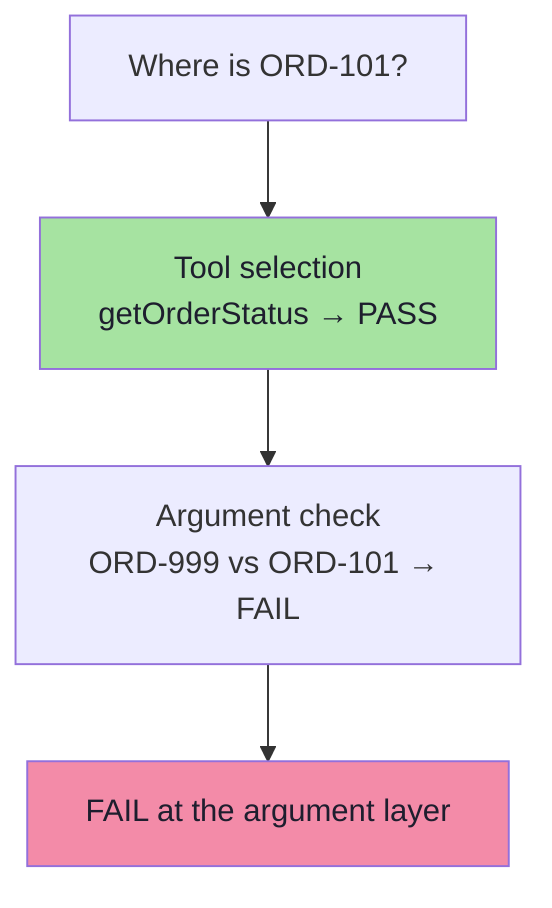
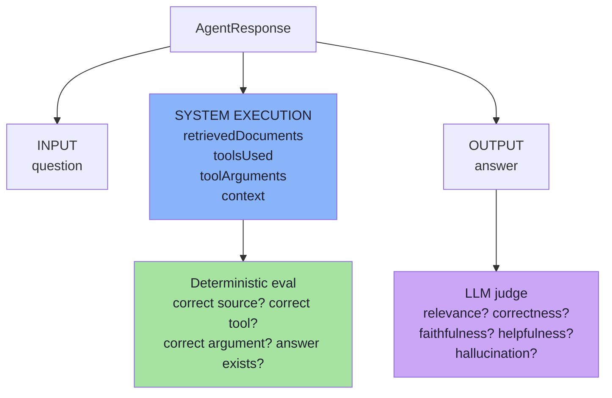
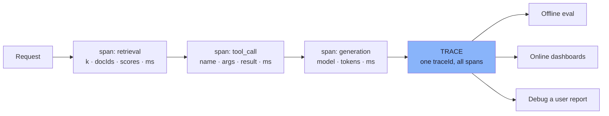

# Chapter 03: Making Agent Behaviour Observable — AgentResponse and Traces

> **Chapter Goal:** Chapter 02 established that the interesting behaviours are *internal*. This chapter makes them **observable**. It defines the `AgentResponse` object — the second output of every request — and explains, field by field, why each piece of internal execution data (`retrievedDocuments`, `context`, `toolsUsed`, `toolArguments`) must be captured if you intend to evaluate anything at all.
>
> The principle is blunt: **if a behaviour is not recorded, it cannot be evaluated, and a bug in it can never be attributed.** Observability is not a nice-to-have dashboard; it is the data layer of the eval system.
>
> At the end of this chapter you should be able to answer: *given this agent, what exactly must I return from `chat()` so that both a deterministic check and an LLM judge can run?*

---

## 3.1 The Problem: A Satisfying Answer Is Not Evidence

Suppose the API only returns:

```text
Yes, you can return it.
```

The user may be satisfied. But **from a testing perspective we know almost nothing.** We do not know:

```text
Which document was retrieved
Whether retrieval happened at all
Whether a tool was called
Which tool was called
Which arguments were passed
What context was given to the LLM
Whether the model simply guessed
```



This becomes a serious testing problem. Two *identical* answers can have completely different levels of trustworthiness:

```text
Answer A:  retrieval returned return-policy → model summarised it        ✅ grounded
Answer B:  retrieval returned nothing       → model guessed from memory  ❌ lucky
```

Both produce `"Yes, you can return it."` Only the trace distinguishes them.

---

## 3.2 An AI Application Is a Pipeline, Not an Input→Output Function



> **If we only test the final answer, we cannot easily determine where the failure occurred.**

| Testing style | What you learn | What you cannot learn |
|---|---|---|
| Final answer only | *Something* is wrong | Which stage failed |
| Pipeline + trace | *Which* stage failed and why | — |

---

## 3.3 AgentResponse — The Second Output of Every Request

For evaluation, the application should expose a small amount of **internal execution information**. Conceptually, `chat()` returns an:

```text
AgentResponse
```

containing information such as:

```text
answer
toolsUsed
toolArguments
retrievedDocuments
context
```



> **The user does not necessarily need to see this trace.** It is mainly useful for **testing**, **debugging** and **observability**.

### 3.3.1 Worked Examples

**Category A response (RAG):**

```text
answer:
"Products may be returned within 30 days of delivery."

toolsUsed:
[]

retrievedDocuments:
["return-policy"]
```

**Category B response (tool):**

```text
answer:
"ORD-101 has been shipped."

toolsUsed:
["getOrderStatus"]

retrievedDocuments:
[]
```

Notice that `toolsUsed: []` on the first and `retrievedDocuments: []` on the second are **not missing data** — they are *assertions that the other path was not taken*. An empty array is evidence.

### 3.3.2 The Trace Shape (from the board)

The board draws the same contract more compactly:

```ts
// pseudo-code — the eval trace returned alongside the answer
type EvalTrace = {
  answer: string;
  toolUsed: string[];          // e.g. ["getOrderStatus"]
  toolResult: string;          // raw result returned by the tool
  argumentPassed: unknown[];   // e.g. ["ORD-101"]
  retrievedDoc: string[];      // e.g. ["return-policy"]
  context: string;             // the exact context given to the model
};
```

The board also shows the **system prompt** as part of the same pipeline, and the **`SupportAgentEvalTest`** as the consumer of the trace:



> **Two consumers, one execution.** The `Client` reads `Response`; the `SupportAgentEvalTest` reads `Traces`. Neither one has to re-run the pipeline.

---

## 3.4 Field-by-Field: Why Each Trace Field Exists

Each field exists because a *specific* evaluation depends on it. Removing any one field silently disables a class of test.

### 3.4.1 Why store `retrievedDocuments`?

Suppose the golden dataset says:

```text
expectedSource:
return-policy
```

And the actual response contains:

```text
retrievedDocuments:
["return-policy"]
```

The evaluation becomes simple:

```text
Expected:  return-policy
Actual:    return-policy
           PASS
```

> **No LLM judge is required.** This is deterministic behaviour.



**What breaks without it:** you can never distinguish *"the model answered without evidence"* from *"the model answered from the right evidence"*. You lose the entire retrieval half of RAG evaluation.

### 3.4.2 Why store `context`?

The context may not be useful to the end user, but it becomes **extremely useful during evaluation**. A faithfulness judge needs:

```text
Question
Retrieved Context
Generated Answer
```

So later we can directly access:

```ts
// pseudo-code
const response = await supportService.chat(question);

const context = response.getContext();
const answer = response.getAnswer();

// both are handed to the judge model
```

The judge can then check whether the answer is supported by **the evidence that was actually available to the model** — not by the evidence you *wish* had been available.

> **Subtle but critical:** faithfulness must be judged against the context the model *received*, not against the whole corpus. If retrieval failed, the model was right to say "I don't have that information" — and a judge fed the full corpus would mark that as unhelpful. Storing `context` prevents this entire class of false accusation.

### 3.4.3 Why store `toolsUsed`?

Suppose the golden dataset says:

```text
expectedTool:
getOrderStatus
```

And the actual trace says:

```text
toolsUsed:
getOrderStatus
```

Then:

```text
PASS
```

> Again, there is **no reason to ask another LLM whether the correct tool was used.** We already know exactly what happened.

### 3.4.4 Why store `toolArguments`?

**Correct tool selection and correct tool arguments are two different behaviours.**

Consider:

```text
getOrderStatus("ORD-999")
```

for the question:

```text
Where is ORD-101?
```

The model selected the correct tool:

```text
Tool Selection:  PASS
```

But it passed the wrong argument:

```text
Tool Argument:   FAIL
```

> **Without storing tool arguments, this distinction would be lost.** The final answer would simply be wrong, and you would have no idea that the tool layer was the culprit — so you would "fix" it by rewriting the prompt, which is the wrong fix.



### 3.4.5 Fields the lecture implies but does not list *(beyond the lecture)*

A production trace should carry a few more fields, because they turn an eval report into a *debuggable* one:

| Field | Why it matters |
|---|---|
| `traceId` / `spanId` | Correlates the eval case with logs, provider dashboards and user reports |
| `model` + `modelVersion` | Half of all "regressions" are a silent provider model update |
| `promptVersion` / `promptHash` | Lets you attribute a score change to a prompt change |
| `temperature` / `topP` / `seed` | Explains run-to-run variance and enables replay |
| `latencyMs` | A quality gain that triples latency is not a gain |
| `inputTokens` / `outputTokens` | Cost per request; early warning for runaway prompts |
| `toolResults` (raw) | Needed to judge faithfulness of tool-derived claims |
| `error` / `finishReason` | Separates "the model said nothing" from "the call failed" |
| `retrievedDocScores` | Retrieval *rank* and *score*, not just the final set (see Chapter 05) |

> **Rule:** if you cannot reconstruct the request from the trace, you cannot reproduce the bug.

---

## 3.5 The Three Layers of Data Available for Evaluation

Our application now gives us **three layers of information**:

```text
INPUT
  question

SYSTEM EXECUTION
  retrievedDocuments
  toolsUsed
  toolArguments
  context

OUTPUT
  answer
```



**This gives us enough information for two types of evaluation.**

| Layer | Fields | Feeds |
|---|---|---|
| Input | `question` | Both (the judge needs the question) |
| System execution | `retrievedDocuments`, `toolsUsed`, `toolArguments`, `context` | Deterministic evals + faithfulness judging |
| Output | `answer` | Quality judging |

> **Note the mapping.** System-execution fields are *facts about your program*; output fields are *language*. Facts go to code, language goes to a judge.

---

## 3.6 Observability Is the Enabling Discipline *(beyond the lecture)*

The lecture's closing argument — *"this is why observability becomes a key part of building production AI applications"* — is worth taking literally.



Practical points that follow from the trace contract:

| Concern | Practice |
|---|---|
| **Correlation** | One `traceId` per request; the eval case id recorded on the trace so failures map back to a dataset row |
| **Standards** | Use an existing tracing convention (e.g. OpenTelemetry's GenAI semantic conventions) instead of inventing field names |
| **PII** | Redact or hash customer identifiers in traces; eval datasets should carry fixture ids, not real ones |
| **Sampling & retention** | Keep 100% of traces in staging/eval; sample in production for cost, but always keep failures |
| **Failure capture** | Persist traces for *failed* eval cases unconditionally — they are the future regression tests |
| **Versioning** | Record prompt version, model version and retrieval index version on every trace |

> **The test to apply to your own system:** *if a customer reports a bad answer from three days ago, can I retrieve the exact context, tool calls and arguments that produced it?* If not, no eval framework will save you.

---

## 3.7 Designing the Trace Contract *(pseudo-code)*

The trace is an **API contract between the application and the eval suite**. Design it once, deliberately.

```ts
// pseudo-code — the shape chat() must return for evaluation to be possible
type AgentResponse = {
  // ---- OUTPUT (for the user) ----
  answer: string;

  // ---- SYSTEM EXECUTION (for the tests) ----
  retrievedDocuments: string[];      // ids of documents actually returned
  retrievedDocScores?: number[];     // optional: rank/score for retrieval metrics
  toolsUsed: string[];               // names, in call order
  toolArguments: unknown[];          // one entry per tool call
  toolResults?: string[];            // raw results (needed for tool-faithfulness)
  context: string;                   // the EXACT context handed to the model

  // ---- METADATA (for attribution) ----
  traceId: string;
  promptVersion: string;
  model: string;
  latencyMs: number;
};
```

```ts
// pseudo-code — how the trace is produced during a single request
async function chat(question: string): Promise<AgentResponse> {
  const trace = startTrace(question);

  // 1. retrieval (may return nothing — that is information, not an error)
  const docs = await vectorStore.search(question, { topK: TOP_K });
  trace.retrievedDocuments = docs.map(d => d.id);

  // 2. tool decision + execution
  const plan = await llm.planWithTools(question, docs);
  for (const call of plan.toolCalls) {
    trace.toolsUsed.push(call.name);
    trace.toolArguments.push(call.args);
    trace.toolResults.push(await runTool(call));
  }

  // 3. generation over the exact assembled context
  trace.context = buildContext(docs, trace.toolResults);
  trace.answer = await llm.generate(question, trace.context);

  return finishTrace(trace);   // the eval suite consumes this object
}
```

> **Design constraints that fall out of this:**
> - `context` must be the *string the model actually saw*, not a re-derivation. Re-deriving it is how you get eval results that disagree with production.
> - `toolsUsed` and `toolArguments` are parallel arrays; keep them index-aligned so a failure names *both* the tool and its bad argument.
> - Retrieval returning `[]` must be a **valid, recorded state**, not an exception — otherwise you cannot test the "no evidence" path.

---

## 3.8 Common Mistakes

| Mistake | Why it hurts | Correct habit |
|---|---|---|
| Returning only `answer` | Nothing is attributable; no deterministic checks possible | Return the trace alongside the answer |
| Exposing the trace to end users | Leaks internal ids, prompts and tool arguments | Keep the trace on a separate channel (logs, eval endpoint, header) |
| Re-deriving `context` inside the test | The test judges context the model never saw | Record the exact context string at generation time |
| Omitting empty arrays | You lose the "this path was *not* taken" assertion | Always record `[]` explicitly |
| Recording only the final tool call | Multi-step agents hide earlier mistakes | Record every call in order |
| No ids, no versions | Cannot correlate a failure with a deploy or a prompt | Add `traceId`, `promptVersion`, `model` |
| Storing raw PII in traces | Compliance risk; datasets get shared | Hash or redact identifiers; use fixture ids |

---

## 3.9 Chapter Summary

| Idea | Statement |
|---|---|
| The core problem | A satisfying answer is **not evidence** of a working system |
| The pipeline | Question → retrieval → tool decision → tool result → generation → answer |
| `AgentResponse` | The application returns the user answer **and** an eval trace |
| `retrievedDocuments` | Enables the retrieval half of RAG evaluation (deterministic) |
| `context` | Enables faithfulness judging against *the evidence the model actually had* |
| `toolsUsed` | Enables deterministic tool-selection checks |
| `toolArguments` | Separates *wrong tool* from *right tool, wrong argument* |
| Three data layers | Input (`question`), system execution (trace fields), output (`answer`) |
| Who consumes what | Facts → deterministic code; language → LLM judge |
| Observability | The enabling discipline: correlate, version, redact, retain |

> **Final mental model for this chapter:** *the answer is a claim; the trace is the evidence.* Everything in Chapters 04–07 operates on the trace — which means the quality of your entire evaluation system is capped by the quality of your trace contract.

---

## Where This Goes Next

- **[Chapter 04](./04_The_Golden_Dataset.md)** — what goes *into* the dataset that this trace will be compared against.
- **[Chapter 05](./05_Deterministic_Evaluation.md)** — the checks that consume `retrievedDocuments`, `toolsUsed` and `toolArguments`.
- **[Chapter 06](./06_LLM_As_A_Judge.md)** — the judge that consumes `question`, `context` and `answer`.
- Cross-lecture: [Lecture 13](../../Lecture%2013/notes/README.md) (structured outputs — the contract that makes traces typed), [Lecture 05](../../Lecture%2005/notes/README.md) (tool-calling agents and their failure modes).

---

**Back to:** [Lecture 18 — Chapter Index](./README.md) · [Complete Consolidated Notes](./Lecture_18_Complete_Notes.md)


