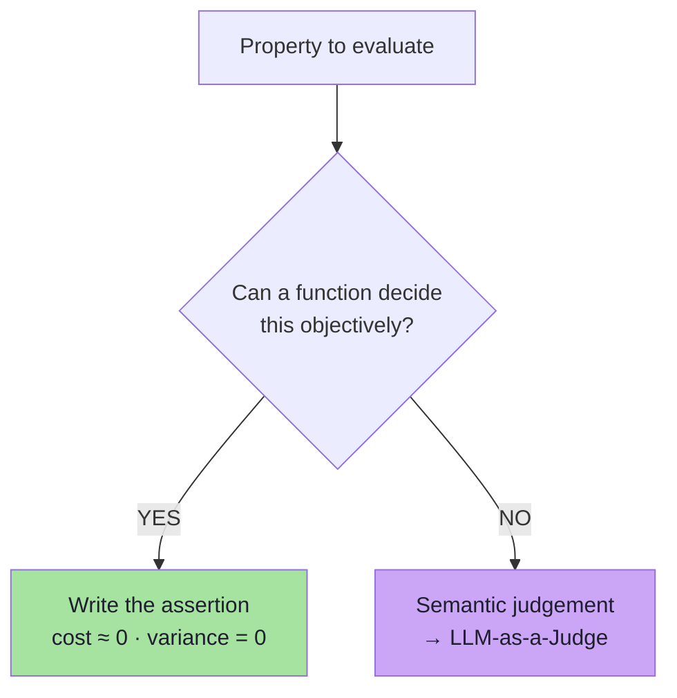
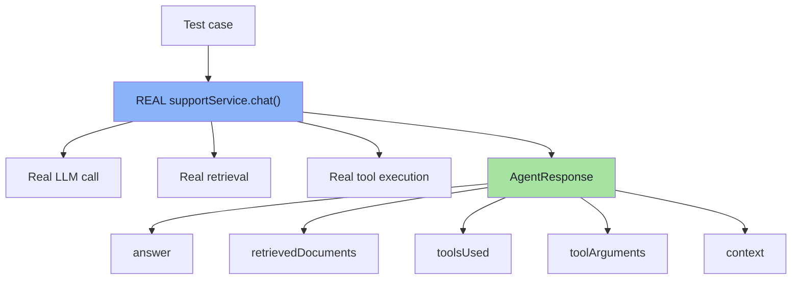
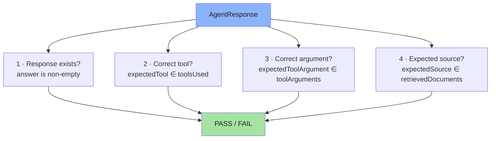
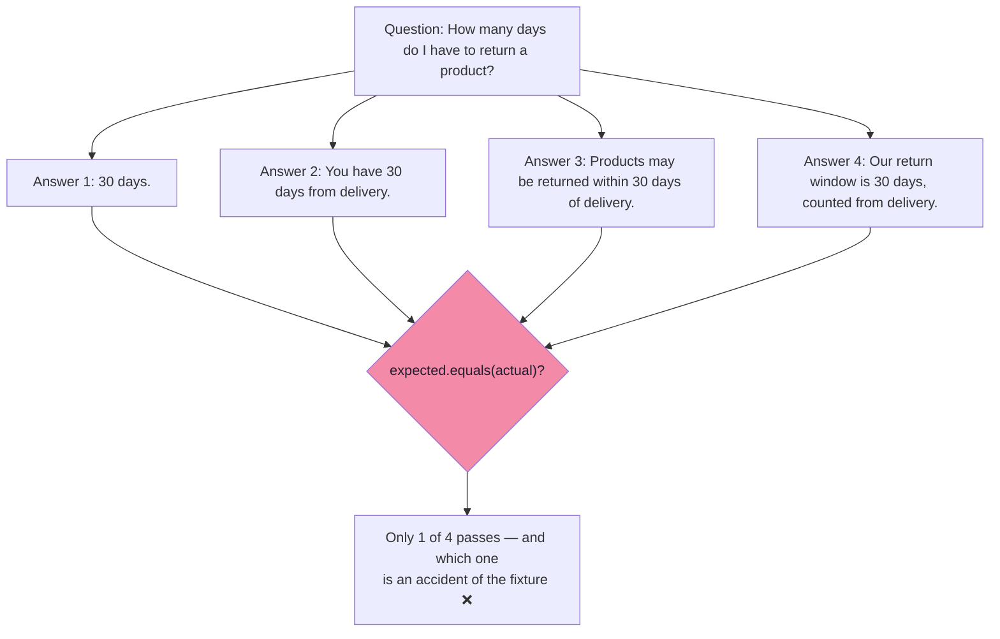
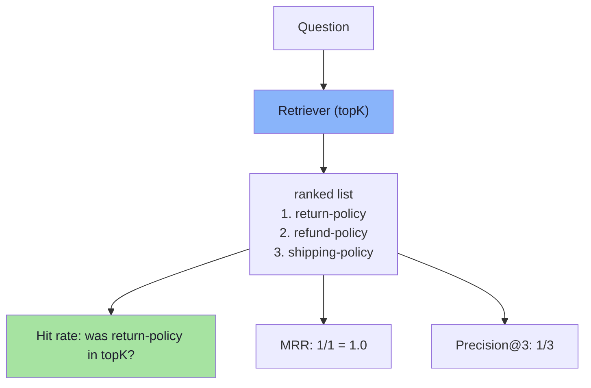

# Chapter 05: Deterministic Evaluation — When Code Is the Judge

> **Chapter Goal:** The lecture's most actionable rule is stated plainly: *"Anything we can reliably evaluate using normal code should be evaluated using normal code."* This chapter covers the first half of the evaluation architecture — the part where **ordinary assertions judge the system's own execution**: did the response exist, was the correct tool called, were the correct arguments passed, was the expected document retrieved.
>
> It also covers the two things the lecture explicitly warns about: **do not mock the AI layer**, and **do not test semantics deterministically**. And it adds the retrieval metrics that make "the right document was retrieved" a number instead of a boolean.
>
> At the end of this chapter you should be able to answer: *which of my quality problems are just assertions I forgot to write — and how do I keep those assertions stable when the model is not?*

---

## 5.1 The Main Principle

Some properties of an AI application are **completely objective**:

```text
Did the expected document get retrieved?
Did getOrderStatus get called?
Was ORD-101 passed to the tool?
```

There is **no semantic judgement involved**. These have exact answers.

> **The main principle:** anything we can reliably evaluate using normal code should be evaluated using normal code.
>
> **There is no need to spend another LLM call on something we already know exactly.**



### 5.1.1 Why this is not a stylistic preference

| Property | Deterministic check | LLM judge |
|---|---|---|
| Cost per case | ≈ 0 | tokens + latency |
| Variance between runs | none | real — the judgement itself varies |
| Debuggability | an exact failing assertion | "the judge said 3 — why?" |
| Runs on every commit in CI | yes | slow and expensive |
| Needs a rubric | no | yes |
| Can be trusted as a hard gate | yes | only after calibration |

> **Rule of thumb:** *use the simplest evaluator capable of judging the behaviour correctly.*

---

## 5.2 Run the Real Application — Do Not Mock the AI Layer

For every test case, we run the **actual application**:

```ts
// pseudo-code
const response = await supportService.chat(evalCase.getQuestion());
```

> **The goal is not to mock the AI layer.** We want the actual system to execute:
>
> ```text
> LLM
> RAG
> Tools
> ```
>
> **because those are the parts we are trying to evaluate.**



### 5.2.1 The mock/no-mock trade-off *(beyond the lecture)*

| Approach | Use it for | Do not use it for |
|---|---|---|
| **Real model + real retrieval + real tools** | The eval suite — this is the thing being measured | Fast unit tests in a tight loop |
| **Mocked LLM** (canned response) | Testing the *eval code itself* (parsers, comparisons, thresholds) | Measuring quality — you are measuring your fixture |
| **Mocked tools** | Testing deterministic argument handling | Measuring tool selection |
| **Recorded/replayed responses** | Reproducing a specific failure | General scoring (the model has moved on) |

> **The trap:** mocking the model makes the test suite fast and green and completely meaningless. Mock only to test your *own* logic; never to score the system.

### 5.2.2 Make the run reproducible *(beyond the lecture)*

```ts
// pseudo-code — freeze what you can before running the dataset
const evalRun = {
  model: "pinned-model-version",
  temperature: 0,                  // minimise sampling variance
  seed: 42,                        // where supported
  promptVersion: "v7",
  retrievalIndex: "snapshot-2026-10-15",
  fixtures: ["ORD-101", "ORD-102", "ORD-103"],   // stable order data
};
```

> If a case fails, the report must say **which** of these knobs was in effect. Otherwise "it passed yesterday" is an unfalsifiable statement.

---

## 5.3 The Deterministic Check Catalogue for This Application

The lecture evaluates four things deterministically:

```text
Response exists
Correct tool was used
Correct tool argument was used
Expected RAG document was retrieved
```

> **These checks behave like normal software tests.** Example output:

```text
Response exists                        PASS
Correct tool                           PASS
Correct tool argument                  PASS
Expected source                        PASS
```



### 5.3.1 Check 1 — Response exists

```ts
// pseudo-code
assert(response.answer != null && response.answer.trim().length > 0);
```

| Catches | Notes |
|---|---|
| Empty completions, provider errors, truncated output | Must not be conflated with a *refusal*, which is a valid answer |

> **Refinement *(beyond the lecture)*:** "response exists" is too weak on its own. Also assert the response is not an **error string**, and that a refusal is only accepted on cases whose expectation *is* a refusal.

### 5.3.2 Check 2 — Correct tool was used

```ts
// pseudo-code — positive and negative forms
assert(response.toolsUsed.includes(evalCase.expectedTool));       // positive
assert(response.toolsUsed.length === 0);                          // negative (Category A)
```

| Catches | Notes |
|---|---|
| Wrong tool chosen, no tool called, extra tool called | Compare on the **tool name**, and on the **call order** if the agent is multi-step |

### 5.3.3 Check 3 — Correct tool argument was used

```ts
// pseudo-code
assert(response.toolArguments.includes(evalCase.expectedToolArgument));
```

> Correct tool selection and correct tool arguments are **two different behaviours**. Recall the worked example:

```text
Question:  Where is ORD-101?
Call:      getOrderStatus("ORD-999")

Tool Selection:  PASS
Tool Argument:   FAIL
```

**Refinements *(beyond the lecture)*:**

| Refinement | Why |
|---|---|
| Compare normalised values (`ORD-101` vs `ord-101`) | Case-sensitivity produces false failures |
| Compare the **whole argument object**, not one field | Multi-argument tools can pass the visible field and garble the rest |
| Assert on *absence* of an argument | Prevents the model inventing a refund amount or a date |

### 5.3.4 Check 4 — Expected RAG document was retrieved

```text
Expected:  return-policy
Actual:    return-policy
           PASS
```

> **No LLM judge is required.** This is deterministic behaviour.

| Refinement | Why |
|---|---|
| Assert **absence** when `expectedSource` is `null` | Catches over-retrieval polluting the context |
| Assert **rank**, not just presence *(see 5.5)* | A document retrieved at position 9 is barely used |
| Compare on a stable **document id**, not the file name | File names change; ids should not |

### 5.3.5 The full check table

| # | Check | Assertion | Deterministic? |
|---|---|---|---|
| 1 | Response exists | `answer` non-empty and not an error | ✅ |
| 2 | Tool used | `expectedTool ∈ toolsUsed` | ✅ |
| 3 | No unexpected tool | `toolsUsed ⊆ expectedTools` | ✅ |
| 4 | Argument passed | `expectedToolArgument ∈ toolArguments` | ✅ |
| 5 | Expected source retrieved | `expectedSource ∈ retrievedDocuments` | ✅ |
| 6 | No unexpected source | `retrievedDocuments ⊆ allowedSources` | ✅ |
| 7 | Refusal when expected | `answer == refusal` for out-of-scope cases | ✅ |
| 8 | Latency budget | `latencyMs <= budget` | ✅ |
| 9 | Token budget | `outputTokens <= budget` | ✅ |
| 10 | JSON/schema validity *(if structured)* | parse + schema validation passes | ✅ |

---

## 5.4 What Should NOT Be Tested Deterministically?

Consider questions such as:

```text
Is the answer correct?
Is the answer useful?
Is it grounded in the evidence?
Did it properly answer the user's question?
```

> **These require understanding natural language and meaning.**

A simple:

```text
expected.equals(actual)
```

**will not work well.** Two answers can mean the same thing while using completely different words.



> **For these situations, we can use LLM-as-a-Judge.**

### 5.4.1 The boundary of determinism

| Property | Deterministic? | Why |
|---|---|---|
| Did the expected document get retrieved? | ✅ Yes | Set membership |
| Did `getOrderStatus` get called? | ✅ Yes | Name equality |
| Was `ORD-101` passed? | ✅ Yes | Value equality |
| Did a response come back at all? | ✅ Yes | Emptiness |
| Was the JSON valid / schema-conformant? | ✅ Yes | Parser / validator |
| Is the answer **correct**? | ❌ No | Many phrasings, one meaning |
| Is the answer **useful**? | ❌ No | Requires judgement |
| Is it **grounded in the evidence**? | ❌ No | Requires claim-by-claim entailment |
| Did it **properly answer** the question? | ❌ No | Requires intent understanding |

> **The practical test:** *can I write the check without ever looking at the meaning of the answer text?* If yes, it is deterministic. If the check has to read the answer and think, it is not.

### 5.4.2 Hybrid checks: substring tests that look deterministic but are not

A tempting middle ground:

```ts
// pseudo-code — fragile, do not do this as a correctness test
assert(response.answer.includes("30 days"));
```

| Problem | Example that breaks it |
|---|---|
| Synonymy | "30-day window", "a month", "thirty days" |
| Negation | "You **cannot** return after 30 days" contains "30 days" |
| Wrong referent | "Shipping takes 30 days" contains "30 days" |

> **Rule:** substring matching is acceptable as a *cheap smoke check* on structured fields (ids, enums, tool names) — never as a correctness test on prose. If the field is prose, use the judge.

---

## 5.5 Retrieval Metrics Are Deterministic Too *(beyond the lecture)*

The lecture's retrieval check is a boolean: *was `return-policy` retrieved?* In production, retrieval quality is better expressed as a small set of deterministic metrics — still code, still free, and they catch regressions a boolean hides.

| Metric | Question it answers | Formula (informal) |
|---|---|---|
| **Hit rate / Recall@k** | Did the expected document appear in the top `k`? | `expected ∈ topK` |
| **Precision@k** | Of the `k` returned, how many were relevant? | `relevantReturned / k` |
| **MRR** | How high did the first relevant document rank? | `1 / rank(first relevant)` |
| **nDCG@k** | Are the *most* relevant documents ranked highest? | graded relevance, position-discounted |
| **Context precision** | How much retrieved context was actually used? | judged per chunk |
| **Context recall** | How much of the needed evidence was retrieved? | judged per reference sentence |



### 5.5.1 Why rank matters more than presence

```text
Case: "How many days do I have to return a product?"

Run 1:  topK = [return-policy, refund-policy, shipping-policy]   → relevant doc at rank 1  ✅
Run 2:  topK = [shipping-policy, refund-policy, return-policy]   → relevant doc at rank 3  ⚠️

Boolean check:  both PASS
MRR check:      1.00 vs 0.33  → a real, visible regression
```

> **This is the exact class of bug behind the `topK 5 → 3` regression from Chapter 01** — and a boolean retrieval check cannot see it until the document falls out of the window entirely.

### 5.5.2 A practical minimum

For a small application, these three deterministic retrieval metrics are worth having on day one:

```text
recall@k        — is the right document there at all?
mrr             — is it ranked highly?
unexpectedDocs  — did anything irrelevant sneak in?
```

All three are pure code, and all three are free to run on every commit.

---

## 5.6 Handling Non-Determinism in "Deterministic" Tests *(beyond the lecture)*

Deterministic checks can still be **flaky**, because they run against a non-deterministic system. The fix is not to make the check probabilistic — it is to make the *run* controlled and the *verdict* stable.

| Flakiness source | Mitigation |
|---|---|
| Model randomly picks a different tool | `temperature: 0`, pin the model version, and assert on the **set of acceptable** tools where the product allows more than one |
| Retrieval order varies | Snapshot the index; assert recall@k rather than exact order |
| Answer length varies | Assert on structural facts (does it state the window?) via the judge, not on length |
| Tool data changes between runs | Fixture ids and a frozen data snapshot |
| Timeouts under load | Assert a generous latency budget, or measure latency as a *metric* rather than a pass/fail gate |
| A rare bad sample | Re-run failing cases `N` times and report a **pass rate** for that case |

```ts
// pseudo-code — re-run a failing case to distinguish a bug from a sample
async function evaluateCaseStable(c: GoldenCase, runs = 3) {
  const results = [];
  for (let i = 0; i < runs; i++) results.push(await evaluateOnce(c));

  const passes = results.filter(r => r.pass).length;
  return {
    id: c.id,
    passRate: passes / runs,                 // 0/3, 1/3, 3/3
    verdict: passes === runs ? "PASS"
           : passes === 0    ? "FAIL"
           : "FLAKY",                        // <-- the useful signal
  };
}
```

> **The `FLAKY` verdict is the most valuable output of this chapter.** A case that passes 2 of 3 times is a real reliability defect that a single-run pass/fail gate will hide forever.

---

## 5.7 The Deterministic Layer as Code *(pseudo-code)*

```ts
// pseudo-code — all deterministic checks for one case, in one place
type CheckResult = { name: string; pass: boolean; detail?: string };

function deterministicChecks(c: GoldenCase, r: AgentResponse): CheckResult[] {
  const norm = (s: unknown) => String(s ?? "").trim().toLowerCase();

  return [
    {
      name: "response exists",
      pass: r.answer.trim().length > 0,
    },
    {
      name: "correct tool used",
      pass: c.expectedTool
        ? r.toolsUsed.map(norm).includes(norm(c.expectedTool))
        : r.toolsUsed.length === 0,              // negative expectation
      detail: `expected=${c.expectedTool} actual=[${r.toolsUsed}]`,
    },
    {
      name: "correct tool argument passed",
      pass: c.expectedToolArgument
        ? r.toolArguments.some(a => norm(JSON.stringify(a)).includes(norm(c.expectedToolArgument)))
        : r.toolArguments.length === 0,
      detail: `expected=${c.expectedToolArgument}`,
    },
    {
      name: "expected source retrieved",
      pass: c.expectedSource
        ? r.retrievedDocuments.map(norm).includes(norm(c.expectedSource))
        : r.retrievedDocuments.length === 0,     // negative expectation
      detail: `expected=${c.expectedSource} actual=[${r.retrievedDocuments}]`,
    },
    {
      name: "latency within budget",
      pass: r.latencyMs <= LATENCY_BUDGET_MS,
      detail: `${r.latencyMs}ms`,
    },
  ];
}
```

> **Note the three design choices in that snippet, because each is a lesson:**
> 1. Every check returns `{ name, pass, detail }` — so a failure prints **the expected and the actual value**, which is what makes a report debuggable.
> 2. `expectedX == null` **inverts** the assertion into a negative one. Negatives are first-class.
> 3. The function is pure: `(case, response) => results`. That makes it trivially unit-testable with a mocked `AgentResponse` — the *only* place mocking belongs (see 5.2.1).

---

## 5.8 Common Mistakes

| Mistake | Why it hurts | Correct habit |
|---|---|---|
| Asking an LLM judge whether the right tool was called | Slower, more expensive, less reliable than `==` | Compare tool names in code |
| Asserting `expected.equals(actual)` on prose | Correct answers fail on wording | Judge prose; assert on structured fields |
| Mocking the model in the eval run | You measure your fixture, not your system | Run the real pipeline; mock only to test eval code |
| Asserting only presence, never absence | Over-retrieval and stray tool calls go undetected | Write negative assertions for `null` expectations |
| Comparing raw strings without normalisation | `ord-101` vs `ORD-101` false failures | Normalise case and whitespace |
| One run, pass/fail verdict | Flaky cases look like clean passes | Re-run and report `FLAKY` |
| Ignoring latency and tokens | Quality improves, cost explodes | Assert budgets deterministically |
| Reporting "test failed" with no values | Nobody can debug it | Include expected vs actual in every failure |

---

## 5.9 Chapter Summary

| Idea | Statement |
|---|---|
| The main principle | **Anything reliably evaluable with normal code should be evaluated with normal code** |
| Why | Cost ≈ 0, zero variance, exact debuggability, runs in CI |
| Run the real system | Do not mock the AI layer — the LLM, RAG and tools are what you are measuring |
| Check 1 | Response exists |
| Check 2 | Correct tool was used (plus: no *unexpected* tool) |
| Check 3 | Correct tool argument was used |
| Check 4 | Expected RAG document was retrieved |
| The boundary | Correctness, usefulness, groundedness and intent are **not** deterministic |
| Rank matters | `recall@k`, MRR and unexpected-document checks catch what a boolean hides |
| Flakiness | Re-run failing cases; a `FLAKY` verdict is a real defect |
| Discipline | Freeze the model version, temperature, index snapshot and fixtures |

> **Final mental model for this chapter:** deterministic evaluation is the **cheap, exact half** of AI testing — the half that runs on every commit and never lies. Write it first, write it broadly, and only reach for a judge when the question genuinely requires understanding meaning.

---

## Where This Goes Next

- **[Chapter 06](./06_LLM_As_A_Judge.md)** — the other half: scoring the semantics that code cannot reach.
- **[Chapter 07](./07_The_Four_Layer_Evaluation_Pipeline.md)** — how the deterministic layer and the judge layer combine into one pass/fail verdict.
- Cross-lecture: [Lecture 13](../../Lecture%2013/notes/README.md) (structured outputs — the contract that makes deterministic checks possible), [Lecture 12](../../Lecture%2012/notes/README.md) (retrieval internals behind recall@k and MRR), [Lecture 17](../../Lecture%2017/notes/README.md) (the general deterministic-check catalogue).

---

**Back to:** [Lecture 18 — Chapter Index](./README.md) · [Complete Consolidated Notes](./Lecture_18_Complete_Notes.md)


