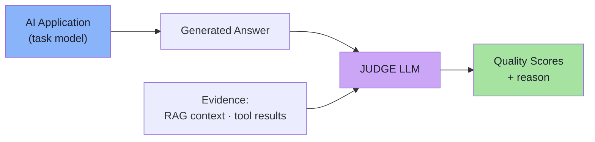
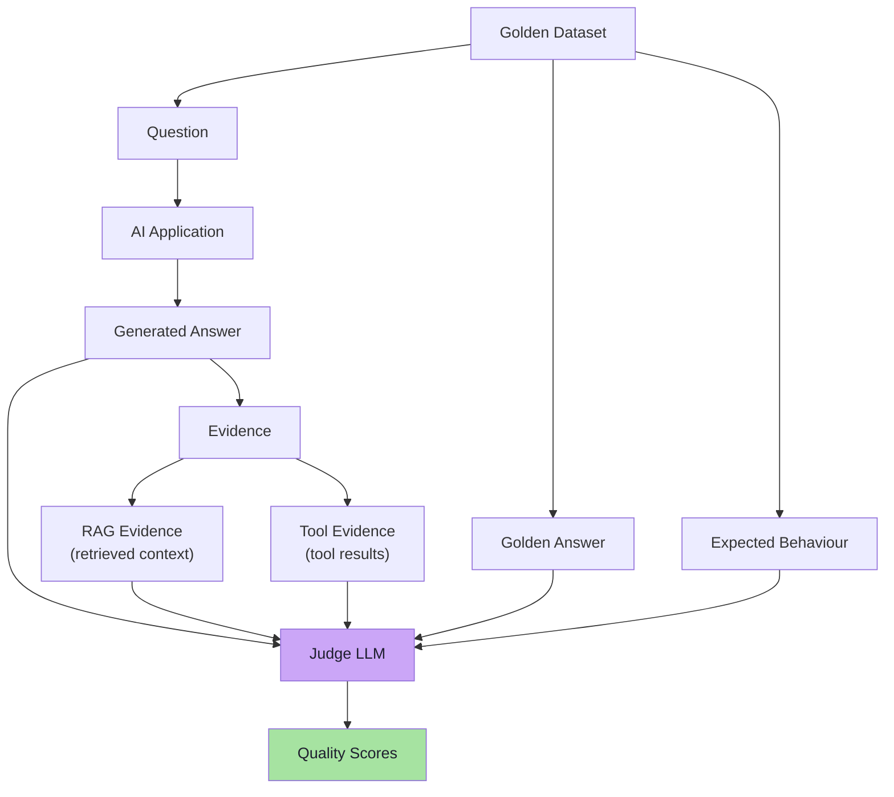
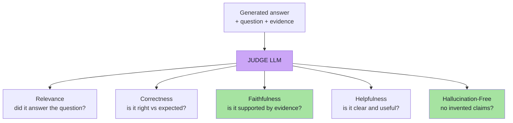
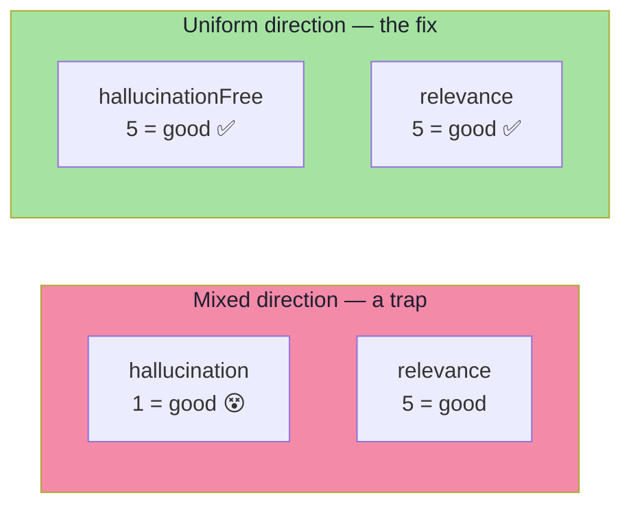
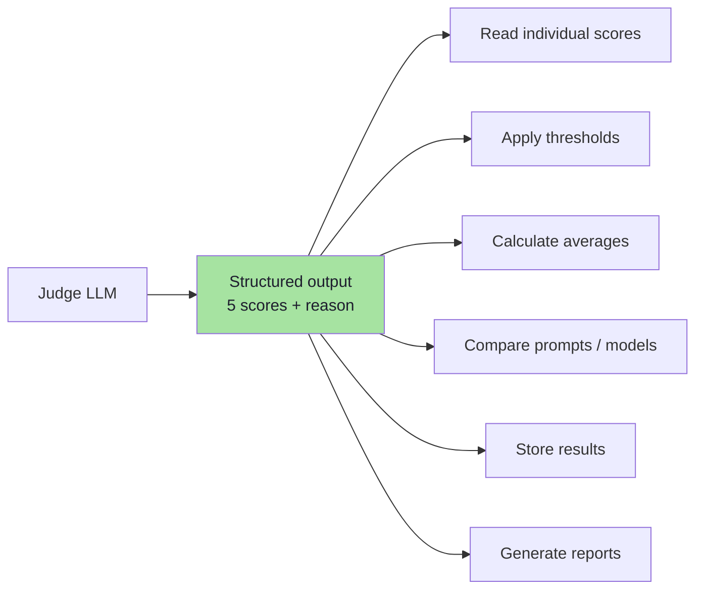
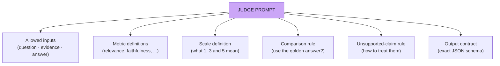
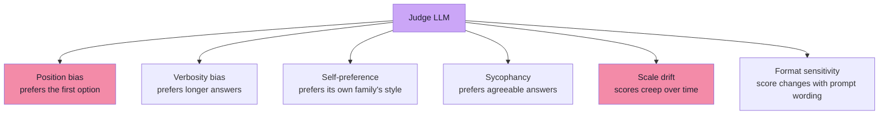
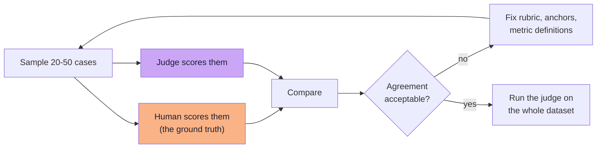

# Chapter 06: LLM-as-a-Judge — Semantic Quality at Scale

> **Chapter Goal:** Deterministic checks judge *behaviour*. They cannot judge *meaning*. This chapter covers the second half of the architecture: a second model — the **judge** — that scores the answer against clearly defined criteria. It defines the five quality metrics for this application, explains the deliberate `hallucinationFree` naming choice, specifies the judge's structured output, and shows why **the judge prompt is the product**.
>
> It then adds what the lecture gestures at but does not spell out: judge prompt anatomy, judge biases and how to mitigate them, calibration against humans, and the cost/latency reality of running a judge over a dataset.
>
> At the end of this chapter you should be able to answer: *how do I score "was this answer actually good?" on 500 cases on every pull request — and still trust the number?*

---

## 6.1 The Idea

The idea is simple:

> **Our main AI application generates an answer. Then another model evaluates that answer according to clearly defined criteria.**



Three roles are now distinct, and keeping them distinct is a design decision:

| Role | Responsibility | Notes |
|---|---|---|
| **Task model** | Produces the answer | The system under test |
| **Judge model** | Scores the answer | Possible to use the same model — risky (self-preference bias) |
| **Human** | Ground truth, calibration, rubric authorship | Slower, more expensive, still necessary |

### 6.1.1 What the judge may receive

The judge may receive:

```text
Question
Golden Answer
Expected Behaviour
RAG Context
Tool Results
Actual Answer
```



> **Notice what the judge is *not* given:** the whole corpus, the source code, or permission to re-answer the question. A judge is a **classifier with a reason field** — not a second assistant. Giving it extra material it was not asked about is the fastest way to make its scores meaningless.

### 6.1.2 What each metric needs *(the input matrix)*

| Metric | Question | Golden Answer | RAG context | Tool results | Actual answer |
|---|---|---|---|---|---|
| Relevance | ✅ | — | — | — | ✅ |
| Correctness | ✅ | ✅ | — | — | ✅ |
| Faithfulness | ✅ | — | ✅ | ✅ | ✅ |
| Helpfulness | ✅ | — | — | — | ✅ |
| Hallucination-free | ✅ | — | ✅ | ✅ | ✅ |

> **Engineering consequence:** because faithfulness and hallucination-free need evidence, **the trace from Chapter 03 is a hard prerequisite for this chapter.** Without `context` and `toolResults`, two of the five metrics cannot be computed at all.

---

## 6.2 Quality Metrics — The Five Dimensions

For this application, we can evaluate **five dimensions**:

| Metric | What are we checking? |
|---|---|
| **Relevance** | Did the response actually answer what the user asked? |
| **Correctness** | Is the answer correct compared with the expected behaviour? |
| **Faithfulness** | Are the factual claims supported by RAG or tool evidence? |
| **Helpfulness** | Is the response clear and useful to the user? |
| **Hallucination-Free** | Did the model avoid inventing unsupported information? |



### 6.2.1 The metrics are not interchangeable

| Metric | Low score means | Fix lives in |
|---|---|---|
| Relevance | The agent answered a *different* question | Prompt, intent handling, retrieval query construction |
| Correctness | The agent answered the right question *wrongly* | Prompt, model, reasoning examples, tool data |
| Faithfulness | The answer contains claims the evidence does not support | Grounding instructions, context assembly, temperature |
| Helpfulness | The answer is correct but unusable — vague, jargon, no next step | Response style, formatting, tone instructions |
| Hallucination-Free | The model invented facts, policies or amounts | Grounding, refusal behaviour, retrieval quality |

> **Why keep them separate:** "quality" is a vector, not a scalar. A blended score of `4.2/5` hides the fact that faithfulness is `2.0` and relevance is `5.0`. Separate metrics tell you *which engineering team owns the fix*.

### 6.2.2 Worked example — a single case scored

```text
Question:   How many days do I have to return a product?
Evidence:   "Products can be returned within 30 days of delivery."
Answer:     "Products may be returned within 30 days of delivery."

Relevance:         5   ← directly answers the question
Correctness:       5   ← matches the policy and the golden answer
Faithfulness:      5   ← every claim appears in the context
Helpfulness:       4   ← correct, but could state the count first
Hallucination-Free:5   ← nothing invented
```

Now a subtly broken variant:

```text
Answer:  "Products may be returned within 30 days of delivery,
          and we also offer free return shipping."
                                          ↑ not in the evidence

Relevance:         5
Correctness:       5
Faithfulness:      2   ← unsupported claim
Helpfulness:       4
Hallucination-Free:2   ← invented policy detail
```

> **This is the case deterministic checks cannot see.** The tool was right, the document was right, the answer exists — and it still contains a policy the company never wrote. Only evidence-grounded judging catches it.

---

## 6.3 Why `hallucinationFree` Instead of `hallucination`

Instead of defining:

```text
hallucination
```

it is easier to define:

```text
hallucinationFree
```

because now **all metrics follow the same scoring direction**:

```text
5 = Good
1 = Bad
```

| Metric | 5 means |
|---|---|
| Relevance | Fully relevant |
| Correctness | Fully correct |
| Faithfulness | Fully supported by evidence |
| Helpfulness | Clear and useful |
| **HallucinationFree** | **No hallucination** |

> **This makes evaluation and aggregation simpler.**



### 6.3.1 The engineering consequences of mixed directions

| If directions are mixed | Consequence |
|---|---|
| Averaging | Averages are meaningless — you would be adding a good number to a bad one |
| Thresholds | `score >= 4` cannot be applied uniformly |
| Dashboards | Every metric needs its own legend; readers get it wrong |
| Regression detection | "Metric went up" is ambiguous — is that good? |
| Judge prompting | The judge itself confuses direction, producing inverted scores |

> **Design rule:** every metric in a scoring system must be oriented so that **higher is better**. If a metric is naturally negative (hallucination, toxicity, cost, error rate), name and score its *negation* (`hallucinationFree`, `toxicityFree`, `costEfficiency`, `successRate`).

### 6.3.2 The same rule applied elsewhere

| Natural (negative) metric | Oriented (positive) metric |
|---|---|
| `hallucination` | `hallucinationFree` |
| `toxicity` | `safety` / `toxicityFree` |
| `missingRetrieval` | `retrievalSuccess` |
| `unexpectedToolCalls` | `toolPrecision` |
| `p95_latency` | `latencyBudgetCompliance` |

---

## 6.4 Structured Output for the Judge

We do **not** want the judge to return something vague like:

```text
"The answer seems pretty good overall..."
```

> That is difficult for our application to process.

Instead, the judge should return **structured output**:

```json
{
  "relevance": 5,
  "correctness": 5,
  "faithfulness": 4,
  "helpfulness": 5,
  "hallucinationFree": 5,
  "reason": "The answer correctly uses the supplied return policy and does not introduce unsupported information."
}
```



**Now the application can:**

```text
Read individual scores
Apply thresholds
Calculate averages
Compare different prompts or models
Store evaluation results
Generate reports
```

### 6.4.1 Why structured output is not optional

| Unstructured judge output | Structured judge output |
|---|---|
| Needs a second LLM call to parse | Parsed with `JSON.parse` |
| Cannot be thresholded | `score >= 4` is a one-line check |
| Cannot be aggregated | Averages, medians, per-category breakdowns |
| Cannot be diffed across versions | Version A vs version B tables |
| Breaks silently when wording changes | Fails loudly on schema validation |
| Cannot be stored in a database meaningfully | Columns per metric, queryable |

> **This is the same lesson as [Lecture 13](../../Lecture%2013/notes/README.md):** the moment you make a model's output a *contract*, it becomes testable. The judge is not exempt — the judge's own output is the most important structured output in the system, because every downstream number depends on it.

### 6.4.2 Validating the judge's output *(beyond the lecture)*

```ts
// pseudo-code — the judge's contract
type JudgeResult = {
  relevance: number;          // 1..5
  correctness: number;        // 1..5
  faithfulness: number;       // 1..5
  helpfulness: number;        // 1..5
  hallucinationFree: number;  // 1..5
  reason: string;
};
```

```ts
// pseudo-code — never trust a judge response without validating it
function parseJudgeResult(raw: string): JudgeResult {
  const parsed = JSON.parse(raw);                     // 1. must be valid JSON
  const keys = ["relevance","correctness","faithfulness","helpfulness","hallucinationFree"];
  for (const k of keys) {
    const v = parsed[k];
    if (!Number.isInteger(v) || v < 1 || v > 5)       // 2. must be 1..5 integers
      throw new Error(`judge returned an invalid ${k}: ${v}`);
  }
  if (typeof parsed.reason !== "string" || !parsed.reason.trim())
    throw new Error("judge returned no reason");       // 3. reason is mandatory
  return parsed as JudgeResult;
}
```

> **A judge failure must be a *test-suite failure*, never a silent zero.** If the judge returns malformed output and your code treats it as `score = 0`, you will chase phantom quality regressions for a week.

### 6.4.3 The reason field is not decoration

| Use of `reason` | Value |
|---|---|
| Debugging a surprising score | Explains *why* the judge decided |
| Human calibration | A reviewer can disagree with the reasoning, not just the number |
| Prompt iteration | You can see which instruction the judge is ignoring |
| Report readability | Stakeholders read reasons, not scores |
| Detecting judge drift | Sudden changes in reasoning style signal a judge-model change |

> **Practical rule:** when a judge score changes, read the `reason` field before you touch the system. Roughly half the time the *judge* changed, not the application.

---

## 6.5 The Judge Prompt Matters

> **The quality of LLM-as-a-Judge depends heavily on the judge prompt.**

A vague instruction such as:

```text
Tell me if this answer is good.
```

will produce **vague and inconsistent results**.

The judge should clearly know:

```text
What information it can use
What each metric means
What the scoring scale means
Whether it should compare with a golden answer
How it should treat unsupported claims
What output format is expected
```



> **The judge itself is still an LLM.** So the evaluation instructions need to be **carefully designed** — with the same care you apply to the production prompt.

### 6.5.1 The six mandatory elements, expanded

| Element | Why it is mandatory | Failure if omitted |
|---|---|---|
| **Allowed inputs** | Prevents the judge inventing external knowledge | It "knows" the policy and marks a correct refusal as wrong |
| **Metric definitions** | Prevents overlap and drift between metrics | Relevance and helpfulness become the same score |
| **Scale definition** | Anchors the meaning of 3 | Scores cluster at 4 with no discrimination |
| **Golden-answer rule** | Determines whether correctness is graded relatively or absolutely | Correct-but-different answers are penalised |
| **Unsupported-claim rule** | Decides how strict faithfulness is | Either everything fails or nothing does |
| **Output contract** | Makes the result parseable | Unparseable output, phantom regressions |

### 6.5.2 A judge prompt skeleton *(pseudo-code)*

```ts
// pseudo-code — the shape of a judge prompt for this application
const judgePrompt = `
You are an evaluation judge. You do NOT answer the user's question.
You score ONE answer using ONLY the material provided below.

INPUTS
  question:        ${question}
  evidence:        ${context}          // RAG context the model actually received
  toolResults:     ${toolResults}      // raw tool output
  goldenAnswer:    ${goldenAnswer}     // reference answer, if one exists
  actualAnswer:    ${answer}

RULES
  - Use ONLY the inputs above. Do not use outside knowledge.
  - Any claim in the answer that is not supported by the evidence
    must lower faithfulness and hallucinationFree.
  - Judge the answer as written, not as you would have written it.
  - A refusal is acceptable ONLY if the evidence is genuinely absent.

SCALE (apply identically to every metric)
  5 = fully satisfies the metric
  4 = satisfies it with a minor gap
  3 = partially satisfies it
  2 = mostly fails it
  1 = completely fails it

OUTPUT — return ONLY this JSON, no prose:
{
  "relevance": 1-5,
  "correctness": 1-5,
  "faithfulness": 1-5,
  "helpfulness": 1-5,
  "hallucinationFree": 1-5,
  "reason": "one or two sentences citing the evidence"
}
`;
```

> **Read the skeleton as a checklist.** Allowed inputs ✅, metric rules ✅, explicit unsupported-claim rule ✅, uniform scale with anchors ✅, exact output contract ✅. Remove any one of those and the judge becomes inconsistent.

### 6.5.3 Common judge-prompt defects

| Defect | Symptom | Fix |
|---|---|---|
| No "use only this material" rule | Judge applies outside knowledge; correct refusals marked wrong | Add an explicit grounding constraint |
| Metrics not defined | Relevance and helpfulness collapse into one score | Define each metric in one sentence |
| No scale anchors | Everything scores 4 or 5 | Define what 1, 3 and 5 mean |
| Asks for prose | Unparseable, unaggregatable | Demand JSON only |
| Asks the judge to *answer* the question | The judge starts solving instead of scoring | State "you do not answer the question" |
| No golden-answer policy | Correct-but-differently-worded answers lose points | Say whether correctness is relative to the golden answer |
| No refusal policy | Honest "I don't know" scores 1 on helpfulness | Define acceptable refusals |
| Multiple metrics in one number | Cannot attribute the failure | One score per metric |

---

## 6.6 Judge Failure Modes and Biases *(beyond the lecture)*

> **The judge is not ground truth.** It is a measuring instrument with known systematic errors. Knowing them is what makes its numbers usable.



| Bias | What it looks like | Mitigation |
|---|---|---|
| **Position bias** | In pairwise judging, the answer shown first wins more often | Swap the order and average the two verdicts |
| **Verbosity bias** | Longer answers score higher regardless of quality | Instruct explicitly: *"length is not quality"*; cap length in the prompt |
| **Self-preference** | A judge favours text from its own model family | Use a different model family for judging where possible |
| **Sycophancy / leniency** | Everything scores 4–5; no discrimination | Anchored scale + a few deliberately bad reference answers in calibration |
| **Scale drift** | Same input, different score next month (judge model updated) | Pin the judge model version; track a fixed "canary" case set |
| **Format sensitivity** | Reordering instructions changes scores | Freeze the judge prompt; version it like production code |
| **Reference-answer leakage** | Judge copies the golden answer instead of judging | Keep the golden answer labelled as reference, not as truth to be restated |
| **Contamination** | The judge has seen the benchmark in training | Prefer private, in-domain cases over public benchmarks |

> **Practical rule:** *a judge score is a measurement, not a verdict.* Before you act on a low score, read the `reason` field and check whether the judge is penalising style, length or a legitimate refusal.

---

## 6.7 Calibrating the Judge Against Humans *(beyond the lecture)*

The judge must be **calibrated**: its scores need to agree with a human's on a sample, or its numbers mean nothing.



| Calibration check | What to look for |
|---|---|
| **Exact agreement** | How often judge score == human score |
| **Adjacent agreement** | How often they differ by at most 1 (the practical bar) |
| **Directional agreement** | When they disagree, does the judge err high or low? |
| **Disagreement themes** | Read the cases where they differ — each theme is a rubric bug |
| **Canary set** | A frozen set with known human scores; re-run after every judge-prompt or judge-model change |

### 6.7.1 The rule of thumb

```text
If the judge cannot reproduce a human on 30 hand-scored cases,
it cannot be trusted on 300 auto-scored ones.
```

> **Where humans still win:** ambiguous policy interpretation, tone and brand voice, safety judgement, and anything where the "correct" answer is a business decision rather than a fact. Use the judge for scale; use humans for the truth.

---

## 6.8 Cost, Latency and Batching *(beyond the lecture)*

A judge doubles the model calls of your eval run. That is affordable only if you are deliberate about it.

| Concern | Practice |
|---|---|
| **Cost** | One judge call per case (not per metric); five metrics in one structured response |
| **Latency** | Run cases in parallel with a concurrency cap; a 500-case suite should take minutes, not hours |
| **Model choice** | Judge quality is usually cheaper to buy than to engineer — but measure agreement first |
| **Prompt size** | Send only the fields the metrics need (see 6.1.2); do not dump the whole trace |
| **Determinism** | `temperature: 0` for the judge, plus a pinned judge version |
| **Caching** | Cache judge results keyed by (case id + answer hash + prompt version) so unchanged cases are not re-scored |
| **Failure policy** | A judge parse failure is a suite error, never a zero score |
| **Tiering** | Deterministic checks first (free) → judge only the cases that pass them, or only a sample in PRs |

### 6.8.1 The cost-aware eval ladder

```text
Level 0 · deterministic checks      free            run on every commit
Level 1 · judge on changed cases    cheap           run on every PR
Level 2 · judge on the full set     moderate        run nightly / pre-release
Level 3 · human review of a sample  expensive       run per release or per incident
```

> **The ladder matters because it makes evals sustainable.** Teams that judge everything on every commit eventually turn the judge off. Teams that tier never have to.

---

## 6.9 The Judge as Code *(pseudo-code)*

```ts
// pseudo-code — run the judge for one case
async function qualityEval(c: GoldenCase, r: AgentResponse): Promise<JudgeResult> {
  const raw = await judgeModel.complete({
    temperature: 0,
    prompt: judgePrompt,                  // see 6.5.2
    variables: {
      question:     c.question,
      context:      r.context,            // the context the model actually received
      toolResults:  r.toolResults ?? [],
      goldenAnswer: c.goldenAnswer,
      answer:       r.answer,
    },
  });

  return parseJudgeResult(raw);           // throws on malformed output (see 6.4.2)
}
```

```ts
// pseudo-code — aggregate the judge over the dataset
function aggregate(results: JudgeResult[]) {
  const metrics = ["relevance","correctness","faithfulness","helpfulness","hallucinationFree"];
  return metrics.reduce((acc, m) => {
    const scores = results.map(r => r[m]);
    acc[m] = {
      mean:   scores.reduce((a, b) => a + b, 0) / scores.length,
      min:    Math.min(...scores),
      below4: scores.filter(s => s < 4).length,
    };
    return acc;
  }, {} as Record<string, { mean: number; min: number; below4: number }>);
}
```

> **Report `min` and `below4`, not only `mean`.** A mean of `4.6` with three cases scoring `1` is a system with three real defects — and a mean-only report hides them completely.

---

## 6.10 Common Mistakes

| Mistake | Why it hurts | Correct habit |
|---|---|---|
| Vague judge prompt ("is this good?") | Scores are inconsistent and unusable | Define inputs, metrics, scale, rules and output format |
| Unstructured judge output | Cannot be thresholded, aggregated or diffed | Demand JSON and validate it |
| Mixed metric directions | Averages and thresholds become meaningless | Use `hallucinationFree`, not `hallucination` |
| Judge given the whole corpus | Faithfulness is judged against evidence the model never had | Pass only the retrieved `context` and tool results |
| Treating judge scores as ground truth | Systematic bias is mistaken for system behaviour | Calibrate against humans; track a canary set |
| Judge model not pinned | Silent judge-model updates look like quality changes | Pin the judge version; re-run calibration on upgrade |
| Judge failure treated as score 0 | Phantom regressions for a week | Fail the suite loudly on malformed output |
| Judging every case on every commit | Cost and latency kill adoption | Use the tiered ladder (6.8.1) |
| Reporting only the mean | Real low-score defects disappear | Report mean, min, and count below threshold |
| Asking the judge to also decide pass/fail | It conflates measurement with policy | The judge scores; the threshold gates |

---

## 6.11 Chapter Summary

| Idea | Statement |
|---|---|
| The idea | A second model scores the answer against clearly defined criteria |
| What the judge receives | Question · golden answer · expected behaviour · RAG context · tool results · actual answer |
| The five metrics | Relevance · correctness · faithfulness · helpfulness · **hallucinationFree** |
| Why five, not one | Quality is a vector; each metric points at a different owner |
| `hallucinationFree` | Named so that **5 = good** for every metric, making averages and thresholds valid |
| Structured output | `{ five scores, reason }` — parsed with `JSON.parse` and schema-validated |
| The judge prompt | The product: inputs, metric definitions, scale anchors, comparison rule, unsupported-claim rule, output contract |
| Not ground truth | Position, verbosity, self-preference and leniency biases are real |
| Calibration | Agree with humans on ~30 hand-scored cases before trusting 300 auto-scored ones |
| Cost control | One call per case, parallel with a cap, cached, tiered by environment |

> **Final mental model for this chapter:** the judge is a **measuring instrument**, not an oracle. You would not trust a thermometer you had never calibrated, and you should not trust a judge you have not calibrated either — but once calibrated, it is the only tool that can score meaning at scale.

---

## Where This Goes Next

- **[Chapter 07](./07_The_Four_Layer_Evaluation_Pipeline.md)** — how the judge's scores combine with deterministic checks and thresholds into one verdict.
- **[Chapter 08](./08_Choosing_Evaluators_And_Thresholds.md)** — when to use the judge at all, and how to gate a release on its output.
- Cross-lecture: [Lecture 17](../../Lecture%2017/notes/README.md) (LLM-as-a-Judge in general: rubrics, pointwise vs pairwise, human evaluation), [Lecture 13](../../Lecture%2013/notes/README.md) (structured outputs — the mechanism behind the judge's JSON contract), [Lecture 04](../../Lecture%2004/notes/README.md) (hallucination and grounding).

---

**Back to:** [Lecture 18 — Chapter Index](./README.md) · [Complete Consolidated Notes](./Lecture_18_Complete_Notes.md)


