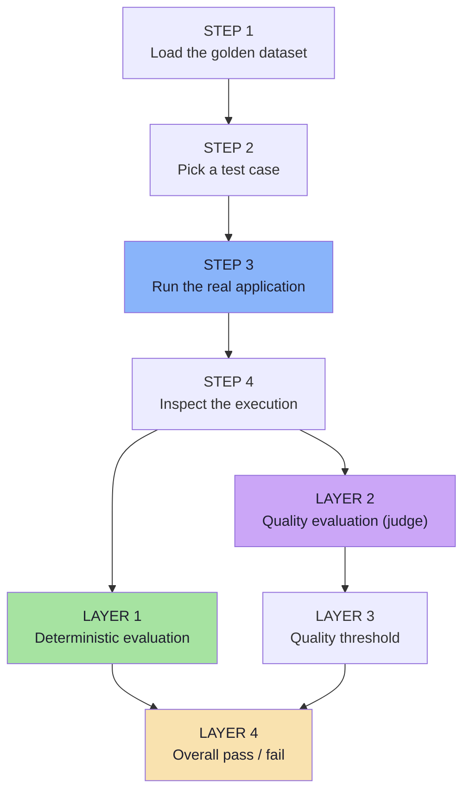
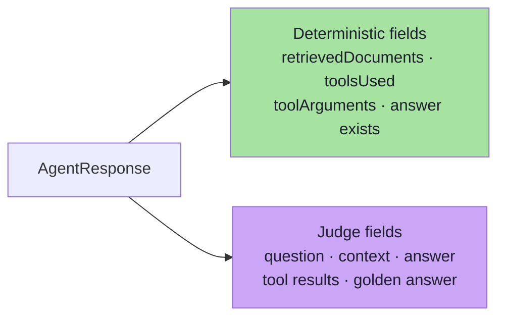
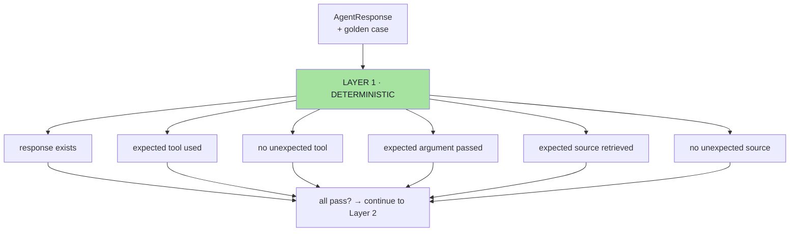
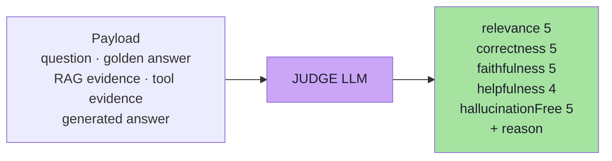
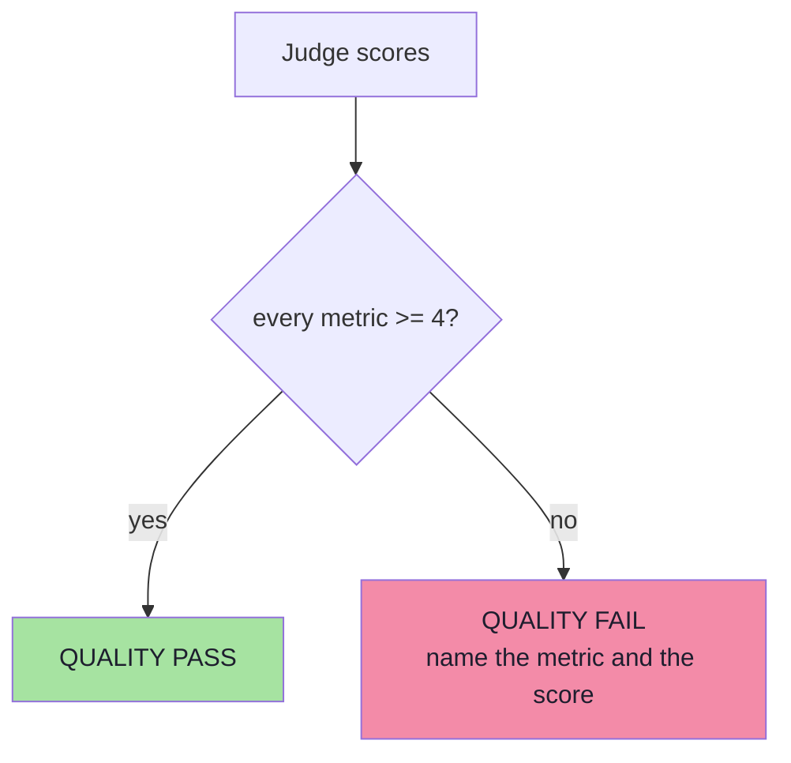
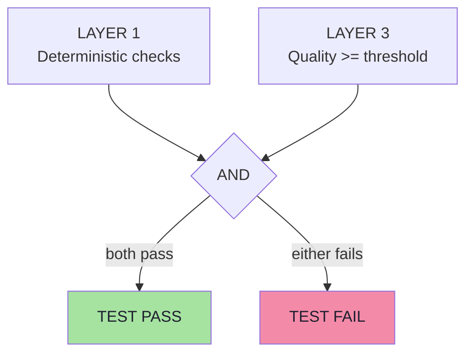
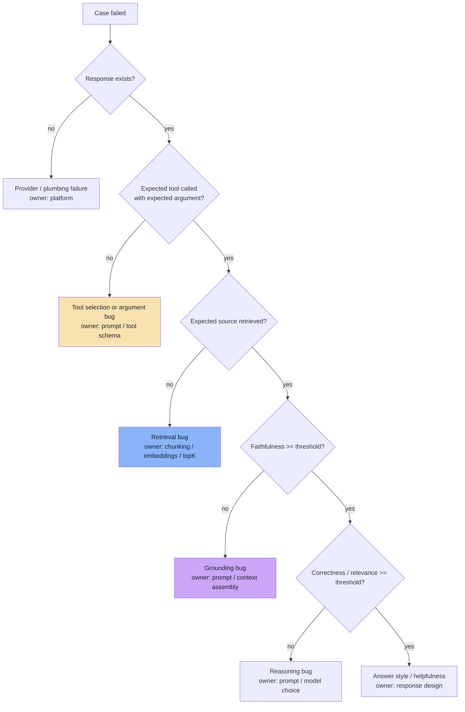
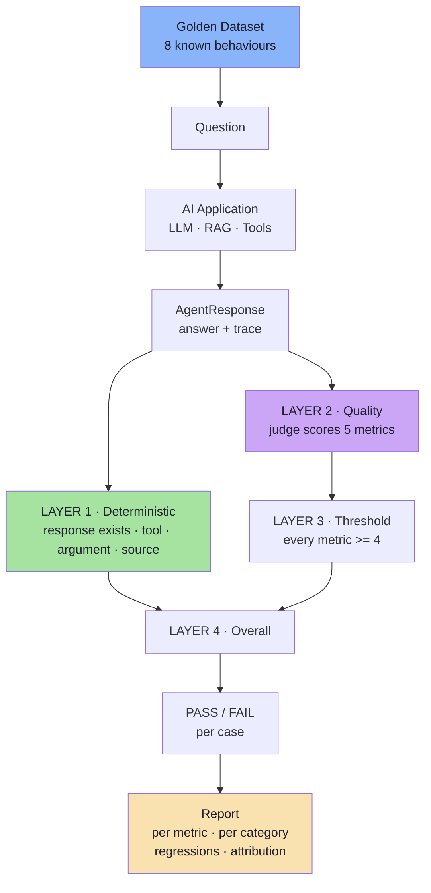
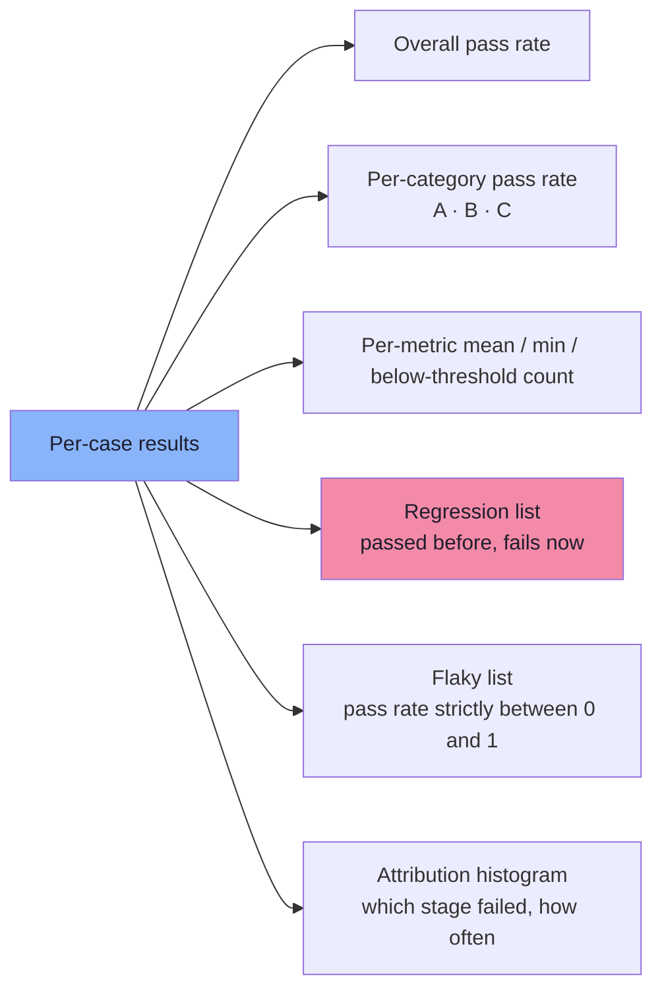

# Chapter 07: The Four-Layer Evaluation Pipeline

> **Chapter Goal:** Chapters 04–06 gave us three separate things: a dataset, deterministic checks, and a judge. This chapter assembles them into the **pipeline** the lecture describes — load the dataset, pick a case, run the real application, inspect the execution, then grade it through four layers: deterministic checks, quality scores, thresholds, and a combined pass/fail.
>
> The pipeline is the deliverable. It is what turns "we have tests" into "we have a number, per case, per metric, with a reason, on every change."
>
> At the end of this chapter you should be able to answer: *for this case, exactly which layer failed, what the expected and actual values were, and who owns the fix?*

---

## 7.1 Why a Pipeline, Not One Big Test Class

> Instead of thinking of the evaluation code as one large test class, it is easier to understand it as a **pipeline**.



Why the pipeline framing is better than a monolithic test class:

| Pipeline view | Monolithic test class |
|---|---|
| Each step is testable in isolation | Hard to test at all |
| Failures name the layer | "The test failed" |
| Reusable across datasets and models | Rewritten per experiment |
| Reportable per case and per metric | A wall of stack traces |
| The same runner powers CI, nightly runs and experiments | Ad-hoc scripts everywhere |

---

## 7.2 Step 1 — Load the Golden Dataset

```text
Golden Dataset
```

This gives us a collection of known test cases. For example:

```text
8 known behaviours
```

```ts
// pseudo-code
const cases: GoldenCase[] = loadJson("src/test/resources/golden-dataset.json");
validateDataset(cases);                 // fail fast on malformed expectations
```

| Detail | Why it matters |
|---|---|
| Loaded **once** per run | The dataset must be identical for every case in the run |
| Validated **before** running | A malformed case wastes a full run |
| Hashed and recorded | The report must name which dataset version produced the scores |

---

## 7.3 Step 2 — Pick a Test Case

Example:

```text
How many days do I have to return a product?
```

```ts
// pseudo-code
for (const evalCase of cases) {
  const result = await evaluateCase(evalCase);
  report.push(result);
}
```

> **The case is the unit of attribution.** Everything downstream is scoped to a case id, so a failure in the report always points at one row of the dataset and one question a human can read.

---

## 7.4 Step 3 — Run the Real Application

```ts
// pseudo-code
const response = await supportService.chat(evalCase.getQuestion());
```

The real:

```text
LLM
RAG
Tools
```

**are allowed to execute.** Nothing is mocked, because these are the components under test.

| Recorded before the call | Why |
|---|---|
| `model`, `promptVersion`, `retrievalIndex`, `temperature`, `seed` | Reproducibility |
| `caseId`, `datasetHash` | Attribution |
| `startedAt` | Correlating with provider logs |

---

## 7.5 Step 4 — Inspect the Execution

Suppose the result is:

```text
retrievedDocuments:
return-policy

toolsUsed:
[]

answer:
Products may be returned within 30 days.
```

> **We now have enough information to evaluate the execution.**



> **This step is a routing decision, not a computation.** It splits the response into the two payloads the two evaluators need — and it is the point at which a missing trace field becomes an obvious, immediate failure rather than a mysterious low score later.

---

## 7.6 Layer 1 — Deterministic Evaluation

Example:

```text
Response exists                    PASS
No unexpected tool                 PASS
Expected source retrieved          PASS
```

> **These are normal software tests. No second LLM is required.**



| Property | Value |
|---|---|
| Cost | ≈ 0 |
| Determinism | Exact — same result every run |
| Failure output | `expected=X actual=Y` |
| Who owns the fix | Retrieval team, tool/prompt team |

> **Note the `No unexpected tool` check.** The lecture's demo lists it explicitly, and it is doing real work: it asserts that on a policy question the agent did **not** reach for the order database. That is a cost, privacy and correctness assertion in one line of code.

---

## 7.7 Layer 2 — Quality Evaluation

Next, send the relevant information to the judge:

```text
Question
Golden Answer
Expected Behaviour
RAG Evidence
Tool Evidence
Generated Answer
```

The judge may return:

```text
Relevance                     5
Correctness                   5
Faithfulness                  5
Helpfulness                   4
Hallucination-Free            5
```

> **These metrics evaluate the semantic quality of the response.**



| Property | Value |
|---|---|
| Cost | tokens + latency per case |
| Determinism | Real variance; pin the judge version and `temperature: 0` |
| Failure output | a score below threshold **plus a reason** |
| Who owns the fix | Prompt / grounding / response-style owners |

> **Layer 2 is the only layer that can see the difference between "correct" and "correct but invented an extra policy".** Layer 1 passes both; only faithfulness judging separates them.

---

## 7.8 Layer 3 — Quality Threshold

For this demo, we can define:

```text
Score >= 4
```

as acceptable **for every quality metric**.

> **There is nothing universal about the number 4.** It is simply a product requirement for this application.



### 7.8.1 Thresholds are product decisions

Different systems may require different thresholds.

**Healthcare or Financial Applications**

> We may need much stricter requirements because incorrect information can have serious consequences.

**Creative Applications**

> Faithfulness may be less important because creativity is part of the expected behaviour.

```text
So thresholds are:
  Product and business decisions, not fundamental constants.
```

| Application | Faithfulness threshold | Rationale |
|---|---|---|
| Financial / healthcare | 5 — no unsupported claim tolerated | A hallucinated figure causes real harm |
| E-commerce support (this demo) | 4 | Some stylistic latitude, facts must be right |
| Marketing copy / creative | 2–3 | Invention is partly the point |
| Internal code assistant | 4 on correctness, 3 on style | Wrong code is costly; phrasing is not |
| Legal / compliance summarisation | 5 on faithfulness, 5 on correctness | Errors are liabilities |

### 7.8.2 Per-metric thresholds, not one global number

```ts
// pseudo-code — thresholds belong to the product, not to the framework
const THRESHOLDS = {
  relevance:         4,
  correctness:       4,
  faithfulness:      4,
  helpfulness:       4,
  hallucinationFree: 4,
};

// optionally stricter for high-severity cases
function thresholdFor(metric: string, c: GoldenCase) {
  return c.severity === "high" ? 5 : THRESHOLDS[metric];
}
```

> **Why per-metric:** relevance and helpfulness are soft signals; faithfulness and hallucination-free are hard correctness signals. Applying one number to all five hides that difference — and makes it impossible to tighten the ones that matter.

---

## 7.9 Layer 4 — Overall Pass / Fail

The final test **combines both layers**:

```text
Deterministic Checks
          PASS
          AND
Quality Scores >= 4
          PASS
            ↓
       TEST PASS
```

If either layer fails:

```text
TEST FAIL
```



> **This is important because a response can fail in different ways.**

### 7.9.1 The three composite failure shapes

```text
Correct final answer
but wrong tool used
```

```text
Correct source retrieved
but final answer incorrect
```

```text
Correct tool and source
but hallucinated extra information
```

| Failure shape | Layer 1 | Layer 3 | Reading |
|---|---|---|---|
| Right answer, wrong tool | ❌ | ✅ | The answer is right **by luck**; the tool layer is broken |
| Right source, wrong answer | ✅ | ❌ | Retrieval is fine; the generation or reasoning is not |
| Right everything, invented detail | ✅ | ❌ (faithfulness) | Grounding is broken; the answer looks perfect |

> **A good evaluation system helps us identify exactly what went wrong.** The AND gate tells you *that* the case failed; the two layers together tell you *where*.

---

## 7.10 Failure Attribution

Attribution is the payoff of the whole architecture. Given one failed case, the layers localise the defect:



> **This decision tree is the single most useful artefact a team can build on top of the pipeline.** It converts "the eval failed" into a ticket with an owner.

### 7.10.1 A worked attribution example

```text
Case B-002: "Where is ORD-101?"

Layer 1:
  response exists              PASS
  correct tool used            PASS   (getOrderStatus)
  correct argument passed      FAIL   (actual: ORD-999)
  expected source retrieved    PASS   (expected: none)

Layer 2:
  relevance 5 · correctness 2 · faithfulness 3
  helpfulness 4 · hallucinationFree 4
```

Reading: the tool layer is correct, the **argument extraction** is broken, and correctness drops because the answer describes the wrong order. One line of the report, one owner, one fix.

---

## 7.11 The Complete Pipeline in One Diagram



Read it in four moves:

1. **A fixed dataset drives the system** — the same questions every run.
2. **The real application executes** — no mocking of the parts under test.
3. **The response is graded twice** — once by code, once by judgement, then thresholded.
4. **The verdicts are reported with attribution** — per case, per metric, per category.

---

## 7.12 Aggregation and Reporting *(beyond the lecture)*

A per-case pass/fail is necessary but not sufficient. The report is what a human acts on.



| Report element | Why it is needed |
|---|---|
| **Overall pass rate** | The headline; the gate reads this |
| **Per-category breakdown** | `A 8/8 · B 6/8 · C 3/8` localises the weakness to a capability |
| **Per-metric mean + min** | A mean hides a `1`; the min and the count-below-threshold do not |
| **Regression list** | The highest-severity signal: something that used to work |
| **Flaky list** | Reliability defects that no single-run gate can see |
| **Attribution histogram** | Tells you where to invest: retrieval, tools, or grounding |
| **Run metadata** | Model, prompt version, dataset hash, judge version, date |

### 7.12.1 A minimal report

```text
RUN 2026-10-15 · model=X@v3 · prompt=v7 · dataset=a91f2c · judge=J@v2

CASES        8 total · 7 pass · 1 fail · 0 flaky
BY CATEGORY  A 3/3 · B 3/3 · C 1/2

METRICS                 mean   min   below-threshold
relevance               4.75   4     0
correctness             4.50   2     1
faithfulness            4.88   4     0
helpfulness             4.38   4     0
hallucinationFree       4.88   4     0

FAILURES
  C-002  "ORD-102 delivered 20 days ago — can I return it?"
         L1 argument passed: expected ORD-102, actual ORD-101
         L2 correctness 2  (reason: answer describes the wrong order)
         ATTRIBUTION: tool-argument layer

REGRESSIONS  none
```

> **That report is the deliverable of the entire lecture.** It names the case, the layer, the expected and actual values, the score, the judge's reason and the owner — and it took no human judgement to produce.

---

## 7.13 The Runner as Code *(pseudo-code)*

```ts
// pseudo-code — the whole pipeline, end to end
async function runEvaluation() {
  // STEP 1 — load
  const cases = loadJson("src/test/resources/golden-dataset.json");
  validateDataset(cases);

  const results = [];

  for (const c of cases) {
    // STEP 2 + 3 — pick the case, run the REAL application
    const response = await supportService.chat(c.question);

    // STEP 4 — inspect: split the trace into the two payloads
    const det  = deterministicChecks(c, response);            // LAYER 1
    const qual = await qualityEval(c, response);              // LAYER 2

    // LAYER 3 — thresholds
    const failingMetrics = Object.entries(THRESHOLDS)
      .filter(([metric, min]) => qual[metric] < thresholdFor(metric, c))
      .map(([metric]) => metric);

    // LAYER 4 — overall verdict
    const pass = det.every(d => d.pass) && failingMetrics.length === 0;

    results.push({
      id: c.id,
      category: c.category,
      pass,
      failedChecks: det.filter(d => !d.pass),
      scores: qual,
      failingMetrics,
      attribution: attribute(det, failingMetrics),   // see 7.10
    });
  }

  return report(results);   // see 7.12.1
}
```

```ts
// pseudo-code — the attribution helper
function attribute(det: CheckResult[], failingMetrics: string[]): string {
  if (!det.find(d => d.name === "response exists")?.pass) return "plumbing";
  if (!det.find(d => d.name === "correct tool used")?.pass) return "tool-selection";
  if (!det.find(d => d.name === "correct tool argument passed")?.pass) return "tool-argument";
  if (!det.find(d => d.name === "expected source retrieved")?.pass) return "retrieval";
  if (failingMetrics.includes("faithfulness")
   || failingMetrics.includes("hallucinationFree")) return "grounding";
  if (failingMetrics.includes("correctness")
   || failingMetrics.includes("relevance")) return "reasoning";
  return "helpfulness/style";
}
```

> **Why this shape matters:** `runEvaluation()` contains no prompts, no model names and no business rules — it is pure orchestration. Prompts live with the prompts, thresholds live with the product, checks live in `deterministicChecks()`. That separation is what lets you change one without breaking the other.

---

## 7.14 Common Mistakes

| Mistake | Why it hurts | Correct habit |
|---|---|---|
| One giant test class | Failures are unattributable; nothing is reusable | Keep the four steps separate and pure |
| Running the judge on cases that failed Layer 1 | You pay to judge an answer that never had a chance | Short-circuit: deterministic first, then judge |
| Treating Layer 1 failure and Layer 3 failure as the same | Different owners, different fixes | Record the layer in the report |
| One global threshold for all metrics | Soft and hard metrics get the same treatment | Per-metric thresholds, stricter for high-severity cases |
| Reporting only the mean | Low-score defects vanish into the average | Report mean, min and count-below-threshold |
| No attribution step | "The eval failed" is not actionable | Classify every failure into a stage |
| Re-running the whole dataset for a one-case fix | Slow feedback loops | Cache results; re-run only affected cases |
| No regression diff against the last accepted run | Silent regressions ship | Compare against the stored baseline |

---

## 7.15 Chapter Summary

| Idea | Statement |
|---|---|
| Why a pipeline | Failures become attributable, reusable and reportable |
| Step 1 | **Load** the golden dataset (validated, hashed, recorded) |
| Step 2 | **Pick** a case — the unit of attribution |
| Step 3 | **Run the real application** — no mocking of the parts under test |
| Step 4 | **Inspect** — route the trace into the deterministic payload and the judge payload |
| Layer 1 | Deterministic evaluation: response exists, tool, argument, source |
| Layer 2 | Quality evaluation: five judge scores + a reason |
| Layer 3 | Quality threshold — `score >= 4` per metric, a **product decision** |
| Layer 4 | Overall verdict — deterministic PASS **AND** quality PASS |
| Failure shapes | Right answer/wrong tool · right source/wrong answer · right everything/invented detail |
| Attribution | A decision tree that maps a failure to an owning team |
| Reporting | Pass rate, per-category breakdown, metric min, regressions, flaky list, attribution |

> **Final mental model for this chapter:** the pipeline is a **conveyor belt with two inspectors**. The first inspector checks the *shape* of what came off the line (fast, exact, free). The second checks the *quality* (slower, judgemental, calibrated). Nothing leaves the belt unless both approve — and every rejection is stamped with the station where it failed.

---

## Where This Goes Next

- **[Chapter 08](./08_Choosing_Evaluators_And_Thresholds.md)** — the decision rule for choosing an evaluator, and how the pipeline becomes a release gate.
- Cross-lecture: [Lecture 17](../../Lecture%2017/notes/README.md) (offline vs online evaluation, the eval loop, and the wider evaluation architecture).

---

**Back to:** [Lecture 18 — Chapter Index](./README.md) · [Complete Consolidated Notes](./Lecture_18_Complete_Notes.md)


