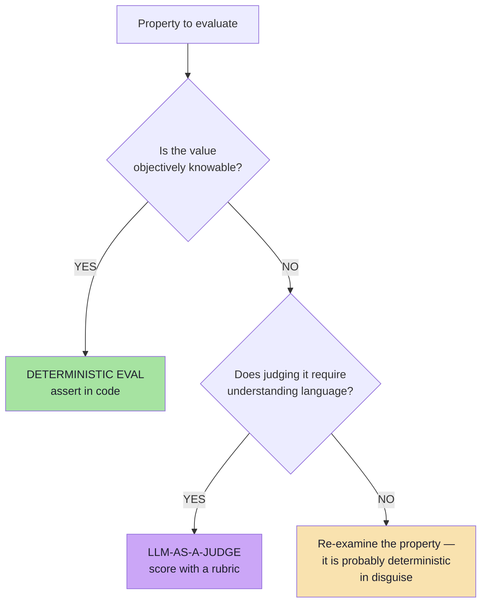
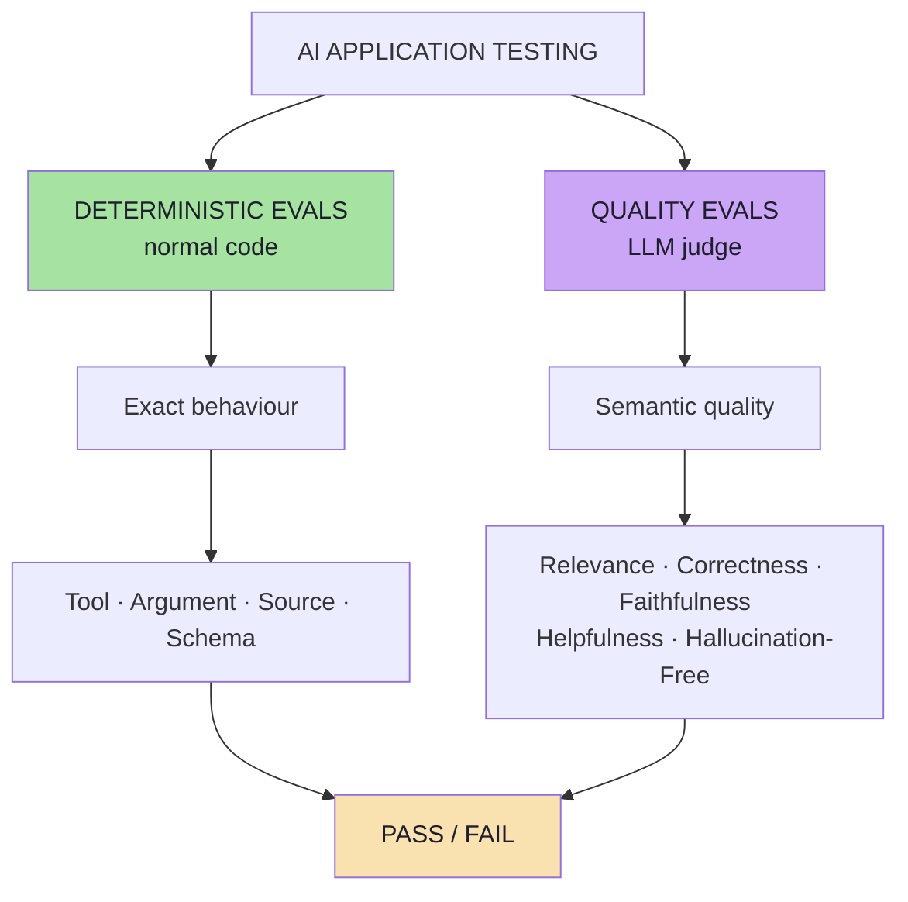
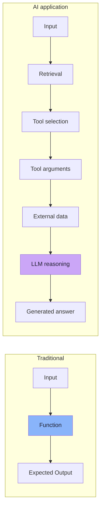
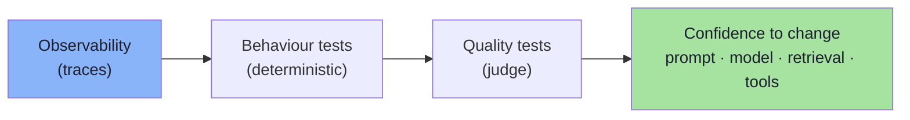
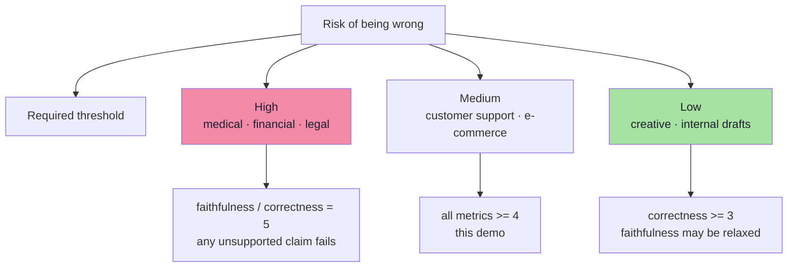
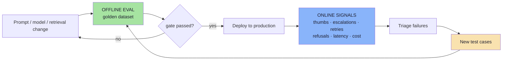
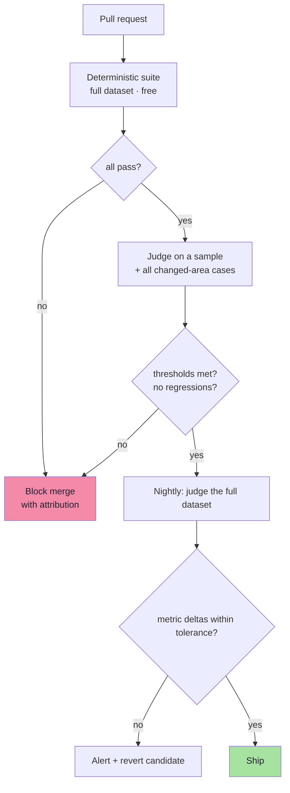
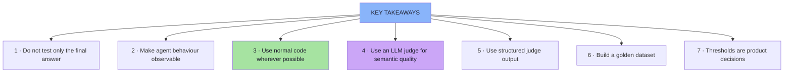
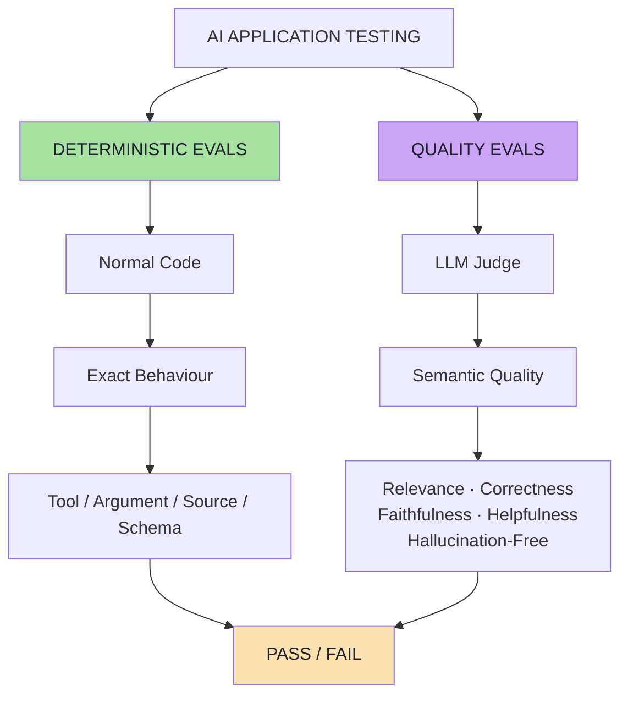

# Chapter 08: Choosing an Evaluator, Thresholds, and Production Reality

> **Chapter Goal:** The final chapter turns the architecture into a **decision procedure**. It states the rule for choosing between deterministic evaluation and an LLM judge, shows why AI evals differ structurally from traditional tests, treats thresholds as product decisions, and places the whole pipeline in a release process — offline before deploy, online after, with the failures flowing back into the dataset.
>
> At the end of this chapter you should be able to answer: *for this specific property, which evaluator do I use — and what does "green" mean for my product?*

---

## 8.1 The Decision Rule

A useful rule is:

> **Use deterministic evaluation when the answer is objectively knowable.**

Examples:

```text
Was a response returned?
Was getOrderStatus called?
Was ORD-101 passed?
Was return-policy retrieved?
Was the JSON schema valid?
```

> **Use an LLM judge when understanding meaning is required.**

Examples:

```text
Was the answer relevant?
Was it correct?
Was it faithful to the evidence?
Was it helpful?
Did it hallucinate?
```

> **Do not use an LLM judge for something that can be checked reliably with normal code.**



### 8.1.1 The one-line test

```text
Can I write this check without reading the meaning of the answer text?
   YES → deterministic
   NO  → judge
```

### 8.1.2 Mapping every property in this lecture

| Property | Evaluator | Why |
|---|---|---|
| Response exists | Deterministic | Emptiness |
| Correct tool called | Deterministic | Name equality |
| Correct argument passed | Deterministic | Value equality |
| Expected document retrieved | Deterministic | Set membership |
| No unexpected tool / source | Deterministic | Set containment |
| Latency / token budget | Deterministic | Numeric comparison |
| JSON / schema validity | Deterministic | Parser |
| Refusal when out of scope | Deterministic *(if the refusal is an enum)* | Value equality |
| Relevance | Judge | Requires intent understanding |
| Correctness | Judge | Many phrasings, one meaning |
| Faithfulness | Judge | Claim-by-claim entailment |
| Helpfulness | Judge | Requires judgement of usefulness |
| Hallucination-free | Judge | Requires evidence comparison |

> **Notice the ratio.** In this application, **eight** properties are deterministic and **five** are semantic. Teams that judge everything are paying for eight checks they could have had for free.

---

## 8.2 Deterministic Evals vs LLM-as-a-Judge — Side by Side



| Dimension | Deterministic eval | LLM-as-a-Judge |
|---|---|---|
| **Decided by** | Normal code | A second model |
| **Input** | The trace | Question + evidence + answer (+ golden answer) |
| **Output** | `PASS` / `FAIL` | A score per metric + a reason |
| **Judges** | *Exact behaviour* | *Semantic quality* |
| **Examples** | Tool, argument, source, schema, latency | Relevance, correctness, faithfulness, helpfulness, hallucination-free |
| **Cost per case** | ≈ 0 | Tokens + latency |
| **Variance** | None | Real |
| **Debuggability** | Exact expected vs actual | A reason field you must read |
| **CI suitability** | Every commit | PR (sample) / nightly (full) |
| **Ground truth?** | Yes, for its own question | No — a calibrated instrument |
| **Typical owner** | Retrieval / tool / platform engineers | Prompt / quality engineers |

### 8.2.1 They are complements, not competitors

```text
Deterministic evals answer:  "did the system do the right thing?"
Quality evals answer:        "was the result of that thing good?"
```

| Scenario | Deterministic | Judge | Who catches it |
|---|---|---|---|
| Retrieval returned nothing, model guessed | ❌ | ✅ (faithfulness) | Both, differently |
| Right tool, wrong order id | ✅ (argument) | ✅ (correctness) | Deterministic, precisely |
| Right evidence, invented extra policy | ✅ | ✅ (faithfulness) | Judge only |
| Empty response from a provider error | ✅ | ✅ (all low) | Deterministic, precisely |
| Correct but rude / unclear answer | ✅ | ✅ (helpfulness) | Judge only |
| Latency tripled | ✅ (budget) | ❌ | Deterministic only |

> **Rule of engagement:** *run the deterministic layer first, always, on everything.* It is free, it is exact, and it prevents the judge from being blamed for failures it never had the information to see.

---

## 8.3 Why AI Evals Are Different From Traditional Testing

Traditional testing often looks like:

```text
Input
  ↓
Function
  ↓
Expected Output
```

AI systems look more like:

```text
Input
  ↓
Retrieval
  ↓
Tool Selection
  ↓
Tool Arguments
  ↓
External Data
  ↓
LLM Reasoning
  ↓
Generated Answer
```



> So a useful AI evaluation strategy tests **both**:
>
> ```text
> Behaviour of the system
> +
> Quality of the final response
> ```

### 8.3.1 The structural differences

| Dimension | Traditional testing | AI evaluation |
|---|---|---|
| **Determinism** | Same input → same output | Output varies; even with `temperature: 0` |
| **Exactness** | One correct output | Many correct phrasings |
| **Unit under test** | A function | A pipeline (retrieval + tools + model) |
| **Expected value** | An exact literal | An expected *behaviour*, plus a reference answer |
| **Assertion style** | `assertEquals` | Behaviour assertions + scored metrics |
| **Verdict** | Binary per assertion | Binary per case **and** aggregates per metric |
| **Ground truth** | The spec | A human, and a calibrated judge as a proxy |
| **Failure mode** | An exception or a wrong value | A fluent, confident, plausible wrong answer |
| **Cost of a run** | Milliseconds, free | Seconds, metered tokens |
| **Where it runs** | CI on every commit | CI (deterministic) + PR/nightly (judge) |
| **What "passing" means** | All assertions pass | Thresholds met and no regressions |

### 8.3.2 The consequence the lecture emphasises

> **This is why observability becomes a key part of building production AI applications.**

Without traces you cannot test behaviour. Without behaviour tests you can only test the final string — which is exactly the thing that is hardest to test and least informative when it fails.



---

## 8.4 Thresholds Are Product Decisions

```text
There is no universal passing score.
```

> **The acceptable quality level depends on the application and its risk.**

| Factor | Effect on thresholds |
|---|---|
| **Risk of harm** | Financial, medical, legal → thresholds near the top of the scale |
| **Reversibility** | An undoable action needs a higher bar than a suggestion |
| **Audience** | Customer-facing > internal tooling > developer scratchpad |
| **Regulatory exposure** | Compliance requirements become hard floors, not targets |
| **Cost of a false negative** | Missing a refund is worse than phrasing it awkwardly |



### 8.4.1 Where the number comes from

```text
Step 1  Run the dataset on the CURRENT system        → establish a baseline
Step 2  Decide what "good enough to ship" means      → a business decision
Step 3  Set the threshold just above the baseline     → ratchet, do not jump
Step 4  Raise it as the system improves               → never lower it silently
```

> **Anti-pattern:** setting the threshold *after* seeing which number makes the build green. A threshold chosen to fit the current output is not a threshold; it is a description.

---

## 8.5 Where the Evaluation Runs: Offline and Online

The same pipeline runs at two different times, for two different purposes.



| | Offline evaluation | Online evaluation |
|---|---|---|
| **When** | Before deploy | After deploy |
| **Input** | The golden dataset | Real traffic |
| **Answers** | "Did this change break anything?" | "Is it working for real users?" |
| **Cost** | Bounded and predictable | Grows with traffic |
| **Blind spot** | Cases nobody wrote down | Cannot re-run the past |
| **Output** | Pass/fail + metric deltas | User signals, incident alerts |

### 8.5.1 Online signals worth capturing *(beyond the lecture)*

```text
thumbs up / down            → a labelled data point
escalation to a human       → a strong negative signal
re-asked question           → the first answer failed
refusal rate                → over-refusal or under-refusal
retrieval-empty rate        → index or query-construction problems
unexpected-tool-call rate   → tool-selection drift
p95 latency, tokens/request → cost and performance regressions
```

> **The loop is the product:** every production failure is a future regression test. Chapter 04's harvest step and this section are the same mechanism seen from two ends.

---

## 8.6 Gating a Release *(beyond the lecture)*



### 8.6.1 Gate policy, stated precisely

```ts
// pseudo-code — what "green" means for this product
function releaseGate(run: Report, baseline: Report) {
  return {
    deterministic: run.failedChecks === 0,             // hard gate, no exceptions
    thresholds:    run.belowThresholdCount === 0,      // hard gate per metric
    regressions:   run.regressions.length === 0,       // hard gate: used to pass
    flaky:         run.flaky.length === 0,             // warn, then escalate
    metricDrift:   withinTolerance(run, baseline, 0.2),// soft gate: <= 0.2 pts
    cost:          run.avgTokens <= TOKEN_BUDGET,
    latency:       run.p95LatencyMs <= LATENCY_BUDGET,
  };
}
```

| Gate | Severity | Rationale |
|---|---|---|
| Deterministic failures | **Hard block** | Exact defects; there is no "mostly correct" tool call |
| Below-threshold scores | **Hard block** | The product requirement was not met |
| Regressions | **Hard block** | Something that used to work stopped working |
| Flaky cases | Warn → escalate | Reliability risk; a warning at first |
| Small metric drift | Warn | Statistical noise on small datasets |
| Cost / latency budget | Hard block if exceeded by a margin | Quality gains must not silently triple cost |

> **The `regressions` gate is the most important line in that function.** Aggregate scores can improve while individual cases break — and a customer will find exactly that case.

---

## 8.7 Key Takeaways

**1. Do not test only the final answer**

> AI applications are pipelines. A wrong answer may originate from retrieval, tool selection, tool arguments, context, or generation.

**2. Make important agent behaviour observable**

Keep track of information such as:

```text
retrievedDocuments
toolsUsed
toolArguments
context
answer
```

**3. Use normal code wherever possible**

> If something can be checked exactly, use deterministic evaluation.

```text
Expected Tool == Actual Tool
```

is better than asking another LLM whether the correct tool was used.

**4. Use LLM-as-a-Judge for semantic quality**

LLM judges are useful for evaluating:

```text
Relevance
Correctness
Faithfulness
Helpfulness
Hallucination-Free
```

**5. Use structured judge output**

> Structured output makes scores easy to process, compare, aggregate, and store.

**6. Build a golden dataset**

> A useful evaluation system starts with known questions and expected behaviours.

**7. Define thresholds according to the product**

> There is no universal passing score. The acceptable quality level depends on the application and its risk.



---

## 8.8 Final Mental Model



> **The core idea is simple:** *Test deterministic behaviour with deterministic code. Use LLM-based evaluation only where understanding language and meaning is actually required.*

---

## 8.9 Chapter Summary

| Idea | Statement |
|---|---|
| The decision rule | Deterministic when the answer is **objectively knowable**; judge when **meaning** is required |
| The one-line test | *Can I write the check without reading the meaning of the answer?* |
| The ratio | Most properties are deterministic; only a few are semantic |
| Why AI evals differ | A pipeline, not a function; behaviour **and** quality |
| Observability | The enabling discipline — no trace, no behaviour test |
| Thresholds | Product and business decisions, not fundamental constants |
| Offline | The golden dataset, before deploy — gates the release |
| Online | Real traffic, after deploy — discovers what you never imagined |
| The loop | Production failures become future regression tests |
| Gating | Hard-block deterministic failures, threshold misses and regressions |
| Key takeaways | Don't test only the answer · make behaviour observable · code first · judge for meaning · structured output · golden dataset · product thresholds |

> **Final mental model for the whole lecture:** an AI application is a probabilistic pipeline, so you grade it the way you would grade any pipeline — **check what is exact with code, score what is semantic with a calibrated judge, gate on thresholds the business chose, and feed every production failure back into the dataset.**

---

## Where This Goes Back To

- **[Chapter 01](./01_Why_AI_Testing_Is_Different.md)** — the pipeline and the attribution problem this chapter's decision rule resolves.
- **[Chapter 03](./03_Observability_AgentResponse_And_Traces.md)** — the trace that makes the deterministic half possible at all.
- **[Chapter 07](./07_The_Four_Layer_Evaluation_Pipeline.md)** — the four layers this chapter's gate is built on.
- Cross-lecture: [Lecture 17](../../Lecture%2017/notes/README.md) (the general theory: rubrics, pointwise vs pairwise, human evaluation, offline/online loops).

---

**Back to:** [Lecture 18 — Chapter Index](./README.md) · [Complete Consolidated Notes](./Lecture_18_Complete_Notes.md)


