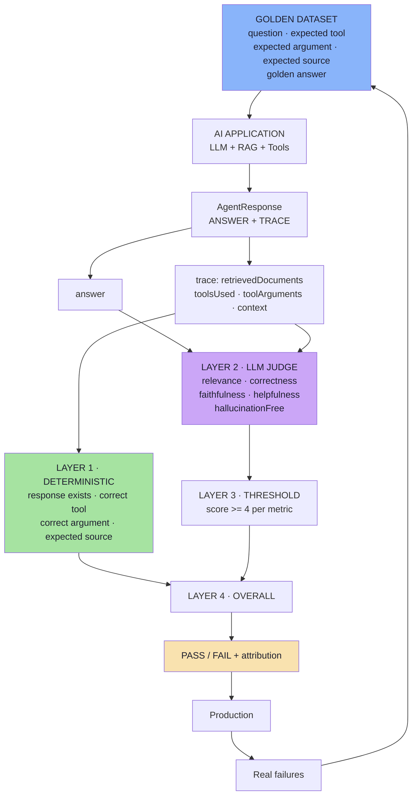

# Lecture 18 — AI Application Testing: Deterministic Evals & LLM-as-a-Judge

> **Lecture theme:** Every lecture before this one answered a *capability* question — *how do we make the AI do something?* Chatbots, agents and tool calling (05), streaming (06), embeddings (07–10), RAG (11–12), structured outputs (13), MCP (14–15), multimodality (16), and the general theory of evals (17). This lecture asks the question that arrives the moment you build a *real* application: **the answer was wrong — which stage of my pipeline was wrong?**
>
> Traditional testing assumes a **deterministic, exact function**: same input, same output, one correct value. An AI application is a **pipeline** — retrieval, tool selection, tool arguments, external data, model reasoning — and the final answer is the *last* stage. So testing only the final answer tells you *that* something failed, never *what* failed.
>
> The lecture's answer has two halves. **Deterministic evals**: if a property is objectively knowable — which tool was called, which arguments were passed, which document was retrieved — check it with ordinary code. **LLM-as-a-Judge**: if a property requires understanding meaning — relevance, correctness, faithfulness, helpfulness, hallucination-freeness — score it with a second model against a rubric. Combine both behind thresholds, and you get a number per case, per metric, with a reason, on every change.
>
> The source lecture uses Java-flavoured illustrative snippets; these notes keep the architecture and express every snippet as **TypeScript-style pseudo-code** for a JS/TS (Node.js) environment. **No runnable production code appears in these notes** — only pseudo-code describing data flow, contracts and data shapes.

---

## Chapter Index

| # | Chapter | Core Question Answered |
|---|---|---|
| [01](./01_Why_AI_Testing_Is_Different.md) | Why AI Application Testing Is Different | Why does testing the final answer tell me nothing about *what* broke? |
| [02](./02_The_Application_Under_Test.md) | The Application Under Test — An E-commerce Support Agent | Which behaviours does each kind of question create? |
| [03](./03_Observability_AgentResponse_And_Traces.md) | Making Agent Behaviour Observable — `AgentResponse` and Traces | What must the application return so that anything can be evaluated? |
| [04](./04_The_Golden_Dataset.md) | The Golden Dataset — Encoding Expected Behaviour | What must be inside a test case, and how do I know my cases are the right ones? |
| [05](./05_Deterministic_Evaluation.md) | Deterministic Evaluation — When Code Is the Judge | Which of my quality problems are just assertions I forgot to write? |
| [06](./06_LLM_As_A_Judge.md) | LLM-as-a-Judge — Semantic Quality at Scale | How do I score meaning on 500 cases and still trust the number? |
| [07](./07_The_Four_Layer_Evaluation_Pipeline.md) | The Four-Layer Evaluation Pipeline | Which layer failed, and who owns the fix? |
| [08](./08_Choosing_Evaluators_And_Thresholds.md) | Choosing an Evaluator, Thresholds, and Production Reality | Which evaluator for which property — and what does "green" mean? |
| [**Complete**](./Lecture_18_Complete_Notes.md) | **Complete Consolidated Notes** | All eight chapters condensed: cheat sheets, decision tables, glossary, self-check |

> 📄 **Prefer a single document?** Read the **[Lecture 18 — Complete Consolidated Notes](./Lecture_18_Complete_Notes.md)**. It keeps the load-bearing ideas, the decision tables and the full architecture, and links back to the chapters for full reasoning and pseudo-code.

---

## The Big Idea in One Diagram

Read it in three parts: **a fixed dataset drives the real application; every response is graded twice — once by code, once by judgement; and production failures flow back into the dataset.**

---

## How to Read These Notes

| Convention | Meaning |
|---|---|
| **Mermaid only** | Every diagram is Mermaid (`flowchart`, `sequenceDiagram`, `stateDiagram-v2`). |
| **TypeScript-style pseudo-code** | Snippets describe data flow and contracts for a JS/TS environment. They are **not runnable production code** and are always labelled. |
| **Board references** | Passages described as *from the board* reproduce the hand-drawn `Excalidraw-Images.svg`. |
| **Beyond the lecture** | Sections marked *beyond the lecture* add material the script only gestures at (non-determinism sources, retrieval metrics, judge bias and calibration, dataset hygiene, CI gating, observability standards). |
| **Cross-lecture links** | Where a topic is really another lecture's subject, it is linked rather than repeated. |

---

## Sources

- 📄 [`Notes.pdf`](./Notes.pdf) — *AI Application Testing: Deterministic Evals & LLM-as-a-Judge* (32 pages): why testing only the final output is not enough, the e-commerce support agent, Category A (knowledge/RAG), Category B (live/tools), Category C (both), the three tools, the application architecture, observable agent behaviour, `AgentResponse` and the eval trace, why to store `retrievedDocuments` / `context` / `toolsUsed` / `toolArguments`, the data available for evaluation, the golden dataset, running the real application, deterministic evaluations, the deterministic checks in the demo, what should not be tested deterministically, LLM-as-a-Judge, the five quality metrics, why `hallucinationFree` instead of `hallucination`, structured judge output, why the judge prompt matters, the complete evaluation pipeline, the four layers, deterministic vs LLM-as-a-Judge, why AI evals differ from traditional testing, the final evaluation architecture, key takeaways and the final mental model.
- 🖼️ [`Excalidraw-Images.svg`](./Excalidraw-Images.svg) — the lecture board: `Client → Server → LLM`, the **E-Commerce chat App** with **Type A / Type B / Type C** questions, `refund-policy.txt · return-policy.txt · shipping-policy.txt` in the vector DB, **OrderStatusTool · DeliveryEstimateTool · RefundAmountTool**, the Type B checks (*"Is correct tool called?" / "Did LLM send the correct OrderId?"*), the combined Type C question (*"My order ORD-102 was delivered 20 days ago. Can I still return it?"*), `Q + context + toolResponse` → **SystemPrompt → LLM → Response + Traces**, the trace shape (`{ answer, toolUsed, toolResult, argumentPassed, retrievedDoc, context }`), **Faithfulness**, the **Golden Dataset** (`Q · expected tool · expected argument · expected doc return`), the deterministic checks (*correct tool? correct arg? correct doc retrieve? tool result?*), the judge inputs (`Q + retrievedContext + Answer`), the judge metrics (*relevance · correctness · faithfulness · helpfulness · hallucination*), the judge's JSON output (`{"relevance":5, ..., "reason":"..."}`), and **`SupportAgentEvalTest`**.
- 📚 Prior lectures — [Lecture 04](../../Lecture%2004/notes/README.md) (hallucination, context), [Lecture 05](../../Lecture%2005/notes/README.md) (agents, tool calling, failure modes), [Lecture 11](../../Lecture%2011/notes/README.md) / [Lecture 12](../../Lecture%2012/notes/README.md) (RAG: chunking, hybrid retrieval, reranking), [Lecture 13](../../Lecture%2013/notes/README.md) (structured outputs — the schema that doubles as a test), [Lecture 14](../../Lecture%2014/notes/README.md) / [Lecture 15](../../Lecture%2015/notes/README.md) (MCP tools, resources, prompts), [Lecture 17](../../Lecture%2017/notes/README.md) (GenAI evals: the general theory this lecture applies).

---

## One-Line Summaries

| Chapter | One-line summary |
|---|---|
| 01 | An AI application is a pipeline, so a wrong answer has many possible causes — and the trace is what separates them. |
| 02 | Three question categories (RAG, tools, both) create the behaviours worth testing. |
| 03 | The answer is a claim; the trace is the evidence. |
| 04 | The dataset defines what "correct" means — write it deliberately. |
| 05 | If code can decide it, code decides it — and it costs nothing. |
| 06 | A judge scores meaning at scale, but only after you calibrate it against humans. |
| 07 | Four layers: deterministic → quality → threshold → overall, with attribution. |
| 08 | Code for the knowable, a judge for the meaningful, thresholds chosen by the business. |

---

## The Lecture in Ten Sentences

1. Traditional software is testable because it is **deterministic and exact**; AI applications are neither.
2. An AI application is a **pipeline** — retrieval, tool selection, tool arguments, external data, reasoning — so testing only the final answer cannot locate a failure.
3. The **support agent** answers three categories of question: knowledge-based (RAG), order-specific (tools), and combined (both + reasoning).
4. Each category creates a different behaviour: **retrieval**, **tool selection**, **tool arguments**, **reasoning**.
5. To test behaviour you must **expose it**: the application returns an `AgentResponse` with `answer`, `retrievedDocuments`, `toolsUsed`, `toolArguments` and `context`.
6. A **golden dataset** of known questions and expected behaviours defines what "correct" means.
7. **Deterministic evaluation** handles everything objectively knowable — response exists, correct tool, correct argument, expected source — with ordinary code.
8. **LLM-as-a-Judge** handles semantic quality across five metrics: **relevance, correctness, faithfulness, helpfulness, hallucinationFree** — returned as structured output with a reason.
9. The **pipeline** grades each case in four layers and combines them into one pass/fail with **attribution**.
10. **Thresholds are product decisions**, and the whole system runs offline before release and online after, with failures feeding back into the dataset.

---

**Back to:** [Lecture 18 — Chapter Index](./README.md) · [Complete Consolidated Notes](./Lecture_18_Complete_Notes.md)

