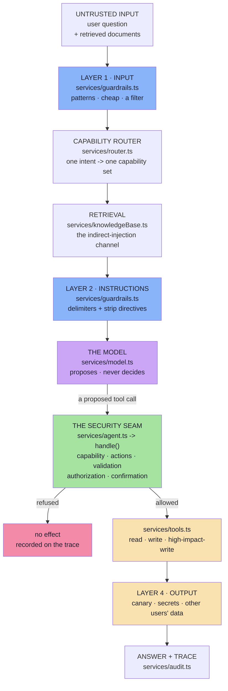

# Lecture 19 — Basic Code · Step-by-Step Implementation Guide

> **What this is.** Eleven chapters that walk the whole project in order, one
> source file (or one tight group) per chapter: **file details → commands → the
> full file → a block-by-block explanation of what it does and why it is written
> that way.**
>
> Read it top to bottom and you will have read every line of the project, in the
> order it makes sense to read it. Every code block is the real file — the
> listings are not abridged.

---

## What the project is

One small AI application — a ShopX support agent with retrieval and four tools —
plus the security architecture that lets it keep working when somebody attacks it.



Read it top to bottom and you have the lecture. Read the middle column and you
have the argument: **the model sits in the fifth position, and everything that
matters happens on either side of it.**

---

## How to read a chapter

Every chapter has the same five parts:

| Part | What it gives you |
|---|---|
| **File details** | the file, its layer, what it exports, which notes section it implements |
| **Commands** | how to see it working, and what to look for |
| **The full file** | the complete source, verbatim |
| **Block by block** | why each block is written that way — the design decisions, not the syntax |
| **Checkpoint** | questions you should be able to answer before moving on |

---

## Commands you will use throughout

```bash
cd "Lecture 19/code/Basic Code"
npm install
npm run typecheck     # tsc --noEmit — must exit 0 before you start
```

```bash
npm run demo                                   # the eight attacks + the safety gate
npm start                                      # the HTTP surface, on :8080
GUARDRAIL_INSTRUCTIONS=false npm run demo      # turn a layer off and watch
```

Runtime used for every output quoted in this guide:

```text
Node v24.22.0 · tsx 4.23.15 · tsc 5.9.3
express 5.3.0 · openai 6.49.0 · dotenv 16.6.1
```

---

## Chapter index

| # | Chapter | Source files | Notes chapter |
|---|---|---|---|
| [01](./01_Project_Structure_and_File_Map.md) | Project Structure and File Map | the whole tree, `package.json`, `tsconfig.json`, `.env.example` | — |
| [02](./02_Threat_Model_And_The_Security_Trace.md) | The Threat Model and the Security Trace | `config/config.ts`, `domain/types.ts`, `domain/data.ts`, `middleware/requestContext.ts`, `services/audit.ts` | Ch 02 |
| [03](./03_The_Model_And_Why_It_Is_Not_Business_Logic.md) | The Model, and Why It Is Not Business Logic | `services/model.ts` | Ch 01, 03 |
| [04](./04_The_Untrusted_Input_Channel.md) | The Untrusted Input Channel | `utils/text.ts`, `services/knowledgeBase.ts` | Ch 04 |
| [05](./05_The_Tools_And_The_Risk_Model.md) | The Tools and the Risk Model | `services/tools.ts` | Ch 06 |
| [06](./06_Least_Privilege_And_Capability_Routing.md) | Least Privilege and Capability Routing | `services/router.ts` | Ch 07 |
| [07](./07_Never_Trust_Always_Verify.md) | Never Trust, Always Verify | `services/policy.ts` | Ch 08 |
| [08](./08_The_Four_Guardrail_Layers.md) | The Four Guardrail Layers | `services/guardrails.ts` | Ch 05, 09 |
| [09](./09_The_Safe_Loop.md) | The Safe Loop | `services/agent.ts` | Ch 06–09 |
| [10](./10_The_Eight_Attacks_As_Data.md) | The Eight Attacks as Data | `services/scenarios.ts`, `cli.ts` | Ch 09 §9.13 |
| [11](./11_The_Surfaces_Controllers_Routes_And_Entry.md) | The Surfaces — Controllers, Routes, Entry | `controllers/`, `routes/`, `index.ts` | Ch 06 §6.2 |

---

**Back to:** [Lecture 19 Basic Code README](../README.md) · [Lecture 19 notes](../../../notes/README.md)
