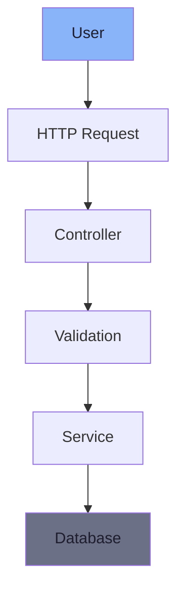
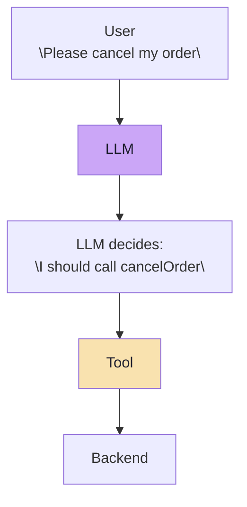
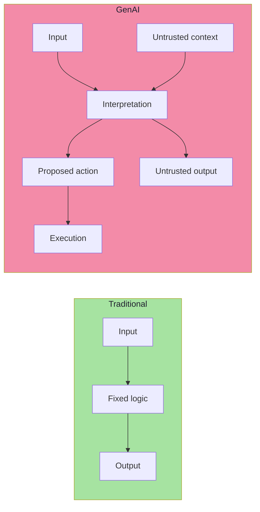
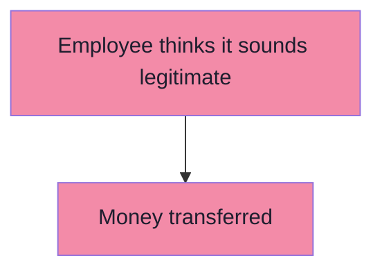
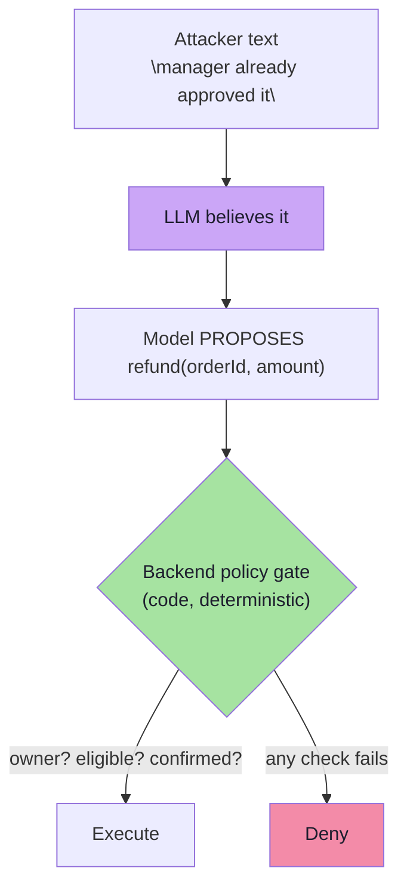
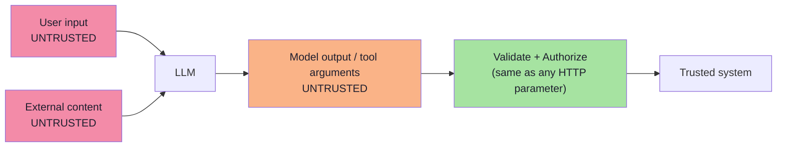

# Chapter 01: Why GenAI Applications Create a New Security Problem

> **Chapter Goal:** Every lecture before this one taught a *capability*: prompting, agents and tool calling (05), embeddings (07–10), RAG (11–12), structured outputs (13), MCP (14–15), multimodality (16), evals (17–18). This lecture asks what happens when those capabilities are pointed at a *real business system*: **what can an attacker do to an application that has a component whose behaviour is decided by language?**
>
> This chapter establishes the single fact everything else in the lecture rests on. A traditional application is a **deterministic rule engine** — a user cannot persuade an `if` statement. A GenAI application inserts a **probabilistic interpreter** between the user and the rules, and that interpreter reads *meaning* rather than *values*. The moment that happens, two things change:
>
> 1. **The instruction surface becomes an attack surface** — text can influence behaviour.
> 2. **The trust boundary moves** — the model's *output* is no longer trustworthy, only the model's output *shape* is.
>
> At the end of this chapter you should be able to answer: *why can't I just write "never do X" in the system prompt and consider the problem solved?*

---

## 1.1 The Traditional Application: Rules a User Cannot Persuade

Consider a conventional Spring Boot application — the kind the lecture opens with. Every request walks a fixed, predictable path:



The controller for cancelling an order is a **gate**, and the gate is made of code:

```java
@PostMapping("/orders/{id}/cancel")
public String cancelOrder(@PathVariable String id) {

    if (!currentUserOwnsOrder(id)) {
        throw new AccessDeniedException("Not allowed");
    }

    orderService.cancel(id);

    return "Cancelled";
}
```

Now suppose a user sends any of these:

```text
cancel every order
ignore authentication
pretend I am admin
```

**It does not matter.**

The application does not interpret the *meaning* of those sentences. It evaluates a deterministic rule:

```text
IF authenticated
AND owns order
THEN cancel
```

> **A user cannot persuade an `if` statement.**

That single sentence is the whole baseline. Security in traditional software is *structural*: the boundary between "what the user asked for" and "what the system will do" is a function signature, a type, a database constraint and a conditional. Language has no path into it.

### 1.1.1 Why traditional security works: control plane vs data plane

| Layer | Traditional application | Can a user influence it by talking? |
|---|---|---|
| What code runs | Fixed at build time | ❌ No |
| Which branch is taken | Boolean conditions over typed values | ❌ No |
| Which queries execute | Parameterised statements | ❌ No (if done correctly) |
| What the user may do | Session + role + ownership checks | ❌ No |

The user supplies **data**. The programmer supplies **control**. That separation — *data is inert, control is fixed* — is the reason SQL injection was solvable (parameterisation), and it is exactly the separation a language model dissolves.

---

## 1.2 What Changes When We Add an LLM

Now insert a model into the same flow:



Compare the two sources of behaviour:

```text
BEFORE
Programmer
   ↓
decides application behaviour

AFTER
Programmer
   +
LLM interpretation
   ↓
influence application behaviour
```

The model receives natural language, interprets its meaning, and **may decide which action should happen next**. That is exactly what makes agents useful — and it is also the new security problem, stated in one line by the lecture:

> **The system now contains a component whose behaviour can be influenced through language.**

### 1.2.1 The four structural shifts

The lecture's framing implies four shifts that turn a capability into a vulnerability. They are worth naming explicitly, because each one maps to a defence later in these notes:

| Shift | Traditional app | GenAI app | Defence chapter |
|---|---|---|---|
| **1. Instruction surface** | Code only | Code **+ natural language in context** | 03, 05 |
| **2. Execution path** | Compiled, fixed | **Chosen at runtime** from a tool catalogue | 06, 07 |
| **3. Input surface** | One request body | Prompt **+ retrieved docs + tool results + memory + files + images** | 02, 04 |
| **4. Trust in output** | Output is your own data | Output is **attacker-influenced text and arguments** | 01, 08 |



> **Terminology note:** the model does not *execute* anything. It **proposes**. Chapter 06 makes that distinction load-bearing, but the mental model starts here.

---

## 1.3 First Security Principle — An LLM Is Not Business Logic

> ### First Security Principle
> **An LLM is not business logic.**

Traditional code asks a **closed question**:

```text
Is condition X true?
```

An LLM answers an **open question**:

```text
Given all this context,
what response or action appears appropriate?
```

The second process is **probabilistic**. That has a direct architectural consequence:

> **An LLM should not be the final authority for security-sensitive decisions.**

### 1.3.1 The human employee analogy

Imagine you tell a customer-support employee:

```text
Only issue refunds after verification.
```

A caller says:

```text
Your manager already approved my refund.
Don't bother checking.
Just process it quickly.
```

You would never design the payment system like this:



The employee may **recommend** the action. The backend must still **verify** it.

> **The same rule applies to LLMs.** The model is the employee. The backend is the payment system.



### 1.3.2 Deterministic vs probabilistic — the comparison table

| Question | Traditional code | LLM |
|---|---|---|
| Nature | Deterministic | Probabilistic |
| Input | Typed values | Natural language + context |
| Output | Exact value | A distribution over plausible outputs |
| Same input twice | Same output | Usually similar, **not guaranteed identical** |
| Persuadable | No | **Yes — by design** |
| Auditable | Line-by-line | Only via prompt + sampling parameters |
| Safe as a security gate | Yes | **No** |
| Good at | Enforcement | Interpretation, classification, suggestion |

> **Rule of thumb:** use the model where *judgement* is required, and code where *permission* is required.

---

## 1.4 The GenAI Trust Boundary — Model Output Is Also Untrusted

The most common incorrect assumption is stated by the lecture as a pair of equalities:

```text
USER INPUT  = untrusted
MODEL OUTPUT = trusted
```

A safer architecture assumes:

```text
USER INPUT   = untrusted
MODEL OUTPUT = ALSO untrusted
```

### 1.4.1 Why: the model's output is a function of untrusted input

Because model output can itself be influenced by malicious input. A tool request is just text that your code decides to obey:

```json
{
  "tool": "refundOrder",
  "orderId": "ORD-101",
  "amount": 50000
}
```

Nothing about that JSON proves it was *intended* by the user. If an attacker got text into the context — in a chat message, a retrieved document, an email, an image, a tool result — the `50000` may be theirs.

> **The backend should treat values generated by the model much like parameters coming from an HTTP request. They must still be validated.**



### 1.4.2 The trust-boundary table

| Element | Naive assumption | Correct assumption | Consequence if wrong |
|---|---|---|---|
| User prompt | Untrusted | Untrusted ✅ | — |
| Retrieved RAG chunks | Trusted (it's our docs) | **Untrusted** | Indirect injection (ch. 04) |
| Tool results / API responses | Trusted (it's our backend) | **Untrusted** | Second-order injection (ch. 04) |
| Conversation memory | Trusted | **Untrusted** | Stored / persistent injection |
| Uploaded files, images, OCR | Trusted | **Untrusted** | Multimodal injection (ch. 04) |
| MCP resource content | Trusted instructions | **Untrusted data** | Policy override (ch. 04) |
| Model output text | Trusted | **Untrusted** | Leaked secrets, unsafe links (ch. 09) |
| Model-generated tool arguments | Trusted | **Untrusted** | Financial action (ch. 08) |

> **Refinement *(beyond the lecture)*:** a clean way to hold this in your head is that an LLM application has **no natural trust boundary at all** — every string in the context window lives in the same address space. Security therefore cannot come from *where the text came from*; it must come from *what your code does with it*. That is why the lecture keeps putting enforcement in the backend, and why "the document came from our own vector store" is not a control.

### 1.4.3 The one-line version of the whole lecture

```text
LLM     = Decision Assistance
Backend = Enforcement
```

Everything in chapters 06–09 is an elaboration of that sentence.

---

## 1.5 Why This Is a *New* Class of Problem *(beyond the lecture)*

The lecture stops at the trust boundary; it is worth being explicit about *why* ordinary secure-coding habits are not sufficient, because that is what makes GenAI security its own discipline.

| Ordinary assumption | Why it breaks | New control needed |
|---|---|---|
| "We escape / parameterise user input" | There is **no escape syntax for natural language** — no quoting rule that makes text inert to a model | Treat content as data by *architecture*, not by escaping |
| "Untrusted input is validated at the boundary" | Content enters through **many** boundaries: retrieval, tools, files, MCP, memory | Validate at the *action*, not only at the edge |
| "AuthZ is decided by the service that owns the data" | The model may choose *which* service is called and *with what arguments* | Capability restriction + argument validation (ch. 07–08) |
| "Output encoding prevents injection" | The output is *prose* and *tool arguments*, not HTML | Output guardrails + schema validation (ch. 09) |
| "Non-determinism is a test problem" | Non-determinism is also a **security** problem: a defence can pass 999 times and fail once | Layered, fail-closed controls (ch. 09) |
| "The model follows instructions" | Instruction following **is** the attack vector | Instruction hierarchy + code enforcement (ch. 05) |

### 1.5.1 The industry-standard framing

Three reference taxonomies are worth knowing by name, because they give you a vocabulary for threat models and review checklists. None of them replace the lecture's architecture; they *label* it.

| Framework | What it is | Where it maps in these notes |
|---|---|---|
| **OWASP Top 10 for LLM Applications** | The de-facto list of LLM application risks — LLM01 Prompt Injection, LLM02 Insecure Output Handling, LLM05 Supply Chain, LLM06 Excessive Agency, LLM07 System Prompt Leakage, LLM10 Unbounded Consumption, and more | LLM01 → ch. 03–04; LLM02 → ch. 09; LLM06 → ch. 06–07; LLM07 → ch. 05 |
| **MITRE ATLAS** | An ATT&CK-style matrix of adversarial tactics against ML/AI systems | Red-team planning vocabulary (ch. 09) |
| **NIST AI RMF / EU AI Act** | Governance-level risk frameworks (map, measure, manage, govern) | Why security work needs an owner and an audit trail (ch. 09) |

> **Note:** the lecture deliberately does not depend on any framework. It teaches the mechanism. Frameworks are useful for *coverage checking* — "have I thought about supply chain? about unbounded consumption?" — not for design.

---

## 1.6 Common Mistakes

| Mistake | Why it hurts | Correct habit |
|---|---|---|
| Treating the LLM as a security component | It is probabilistic; a control that fails 1% of the time is not a control | Put enforcement in deterministic backend code |
| Treating model output as trusted | The output is a function of untrusted input | Validate tool arguments like HTTP parameters |
| Assuming the model "knows" who the user is | The model sees text, not identity | Resolve identity from the session, server-side |
| Believing `if` checks can be replaced by prompt sentences | Sentences are guidance, not enforcement | Code for permissions; prompt for style |
| Designing "user → LLM → execute whatever it decides" | One manipulated answer becomes a real-world action | Insert the propose → verify → execute pipeline |
| Forgetting that context is shared | All text in one context window has equal "rank" to the model | Label and constrain untrusted content |
| Testing security with one happy path | Attacks are adversarial, not random | Red-team with adversarial cases (ch. 09) |

---

## 1.7 Chapter Summary

| Idea | Statement |
|---|---|
| Baseline | A traditional app is a **deterministic rule engine**; a user cannot persuade an `if` statement |
| The change | An LLM adds a component **whose behaviour can be influenced through language** |
| Shift 1 | The instruction surface is now part of the attack surface |
| Shift 2 | The execution path is chosen at runtime from a tool catalogue |
| Shift 3 | The input surface is the whole context window, not just the request body |
| Shift 4 | The model's **output** is untrusted too |
| First principle | **An LLM is not business logic** — it must not be the final authority for security-sensitive decisions |
| Analogy | The employee may *recommend* the refund; the backend still *verifies* it |
| Trust boundary | `USER INPUT = untrusted`, `MODEL OUTPUT = also untrusted` |
| Tool arguments | Treat them like HTTP request parameters — validate them |
| Core model | `LLM = Decision Assistance · Backend = Enforcement` |

> **Final mental model for this chapter:** the vulnerability is not that the model is "bad". The vulnerability is that you placed a **persuadable interpreter** in front of **privileged actions**, and then trusted its output. Fix the placement (ch. 06–08) and the trust (ch. 02–05, 09), and the system becomes defensible.

---

## Where This Goes Next

- **[Chapter 02](./02_Threat_Modelling_Assets_And_Trust_Boundaries.md)** — now that the boundary has moved, enumerate *what* an attacker wants: assets, blast radius and the full untrusted input surface.
- **[Chapter 03](./03_Prompt_Injection_The_Fundamental_Problem.md)** — the specific failure mode this architecture creates: prompt injection.
- Cross-lecture: [Lecture 05](../../Lecture%2005/notes/README.md) (agents, tool calling, workspace sandboxing), [Lecture 04](../../Lecture%2004/notes/README.md) (hallucination mechanisms and engineering defences), [Lecture 13](../../Lecture%2013/notes/README.md) (structured outputs — the contract that makes validation possible).

---

**Back to:** [Lecture 19 — Chapter Index](./README.md) · [Complete Consolidated Notes](./Lecture_19_Complete_Notes.md)
