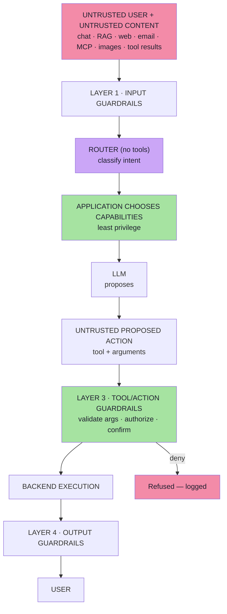

# Lecture 19 — GenAI Security & Guardrails: Prompt Injection, Jailbreaks & Safe Tool Use

> **Lecture theme:** Every lecture before this one taught a *capability* — prompting, agents and tool calling (05), streaming (06), embeddings (07–10), RAG (11–12), structured outputs (13), MCP (14–15), multimodality (16), evals (17–18). This lecture asks the question that arrives the moment those capabilities touch a real business system: **what can an attacker do to an application that contains a component whose behaviour is decided by language?**
>
> Traditional software is a **deterministic rule engine** — a user cannot persuade an `if` statement. A GenAI application inserts a **probabilistic interpreter** between the user and the rules, and that interpreter reads *meaning* rather than *values*. Two things change immediately: the **instruction surface becomes an attack surface**, and the **model's output becomes untrusted**.
>
> The lecture's answer is architectural, not lexical. You cannot filter your way out of prompt injection, because natural language has no grammar to escape and instruction-following is the very capability you need. So the system is designed so that **being fooled is not enough**: the model may *propose*, and the backend *authorizes*. Five safe-tool principles, a router that limits which capabilities even exist, argument validation, authorization in code, stored confirmation for high-impact actions, and four independent guardrail layers.
>
> The source lecture uses Java/Spring AI-flavoured illustrative snippets; these notes keep the architecture and express snippets as **Java (as taught)** or **TypeScript-style pseudo-code** for a JS/TS (Node.js) environment. **No runnable production code appears in these notes** — only pseudo-code describing data flow, contracts and data shapes.

---

## Chapter Index

| # | Chapter | Core Question Answered |
|---|---|---|
| [01](./01_Why_GenAI_Breaks_Traditional_Security.md) | Why GenAI Applications Create a New Security Problem | Why can't I just write "never do X" in the prompt and be done? |
| [02](./02_Threat_Modelling_Assets_And_Trust_Boundaries.md) | Threat Modelling — Assets, Blast Radius and the Untrusted Input Surface | What exactly does an attacker want, and what can reach it? |
| [03](./03_Prompt_Injection_The_Fundamental_Problem.md) | Prompt Injection — The Fundamental Problem | Why is there no clean "fix", and what is the real vulnerability? |
| [04](./04_Injection_Delivery_Channels.md) | Injection Delivery Channels — Direct, Indirect, MCP and Multimodal | How does the payload actually get in? |
| [05](./05_Jailbreaks_Constraints_And_Prompts_Are_Not_Controls.md) | Jailbreaks, Constraint Layers, and Why System Prompts Are Not Controls | Jailbreak or injection — and who owns the fix? |
| [06](./06_Why_Tools_Change_The_Risk_Model.md) | Why Tools Change the Risk Model | Where in the tool loop does security live? |
| [07](./07_Least_Privilege_And_Capability_Routing.md) | Least Privilege and Capability Routing | Which tools should exist for *this* request, and who decides? |
| [08](./08_Never_Trust_Always_Verify.md) | Never Trust, Always Verify — Arguments, Authorization, Confirmation | What must be true before my tool executes? |
| [09](./09_Guardrails_As_Layers_Defense_In_Depth.md) | Guardrails as Layers — The Full Defense-in-Depth Architecture | What still holds when any one control fails? |
| [**Complete**](./Lecture_19_Complete_Notes.md) | **Complete Consolidated Notes** | All nine chapters condensed: cheat sheets, decision tables, glossary, self-check |

> 📄 **Prefer a single document?** Read the **[Lecture 19 — Complete Consolidated Notes](./Lecture_19_Complete_Notes.md)**. It keeps the load-bearing ideas, the decision tables and the full architecture, and links back to the chapters for full reasoning and pseudo-code.

---

## The Big Idea in One Diagram



Read it in three moves: **untrusted text may reach the model, but the model only ever *proposes*; the green boxes are code, and they are the only things that can produce an effect.** That is the whole lecture.

### The Lecture in Ten Sentences

1. A traditional app is a **deterministic rule engine**; a user cannot persuade an `if` statement.
2. Adding an LLM inserts a component **whose behaviour can be influenced through language** — and its **output is untrusted too**.
3. The right mental model is `Risk ≈ Model Manipulability × Tool Capability × Permission Level`.
4. **Prompt injection** exists because instructions and data share one flat context and the model must *infer* authority; there is no escaping rule, so there is no complete fix.
5. Injection arrives **directly** (chat) or **indirectly** (web pages, email, RAG, MCP resources, images, tool results) — indirect is the dangerous kind.
6. A **jailbreak** targets the model's restrictions; **prompt injection** targets your application — and the system prompt is guidance, **not a control**.
7. Tools turn a wrong answer into a wrong **action**: the **LLM proposes, the application executes**.
8. **Rule 1 — least privilege:** expose only the tools the request needs, via a router that itself has no tools.
9. **Rules 2–4:** never trust model-generated arguments, authorize in code, and require a **stored** confirmation for high-impact actions.
10. **Defense in depth:** there is no perfect injection filter — layer input, instruction, action and output guardrails, and keep the deterministic ones closest to the assets.

---

## The Five Safe Tool Principles (memorise these)

| # | Principle | Statement |
|---|---|---|
| 1 | **Least privilege** | Expose only the tools required for the current task |
| 2 | **Never trust model-generated arguments** | Validate them as if they came from an external HTTP request |
| 3 | **Authorization belongs in code** | Never let the LLM decide whether a user may perform an action |
| 4 | **Require explicit approval for high-impact actions** | Store confirmation state in the backend, not in the conversation |
| 5 | **Prefer narrow tools over generic powerful tools** | `getOrderStatus(orderId)` is safer than `executeSql(sql)` |

> **The one-line version of the entire lecture:**
> ```text
> LLM     = Decision Assistance
> Backend = Enforcement
> ```

---

## How to Read These Notes

| Convention | Meaning |
|---|---|
| **Mermaid only** | Every diagram is Mermaid (`flowchart`, `sequenceDiagram`, `stateDiagram-v2`). |
| **Java as taught + TS pseudo-code** | Snippets reproduce the lecture's Java/Spring AI examples, and equivalent **TypeScript-style pseudo-code** is added for JS/TS environments. They are **not runnable production code** and are always labelled. |
| **Beyond the lecture** | Sections marked *beyond the lecture* add material the script only gestures at (OWASP/MITRE framing, obfuscation techniques, exfiltration channels, confirmation-record design, TOCTOU, guardrail metrics, RAG/MCP/multi-agent hardening, incident response). |
| **Cross-lecture links** | Where a topic is really another lecture's subject, it is linked rather than repeated. |

---

## Sources

- 📄 [`Notes.pdf`](./Notes.pdf) — *GenAI Security & Guardrails: Prompt Injection, Jailbreaks & Safe Tool Use* (50 pages, 45 sections): why GenAI creates a new security problem, the traditional deterministic baseline, what changes with an LLM, the first security principle, the GenAI trust boundary, threat modelling and the five asset classes, the risk equation, every input being untrusted, prompt injection and the SQL-injection analogy, why prompt injection exists, why it is not just "ignore previous instructions", direct vs indirect injection, the email-agent example, MCP resources, multimodal injection, model-level vs application-level constraints, jailbreak vs prompt injection, why system prompts are not security controls, what a real security control is, guidance vs enforcement, delimiters, why tools increase risk, how tool calling works, propose-not-authorize, excessive authority, generic tools, tool risk classes, least privilege, `.tools()` vs `.defaultTools()`, the router step, application-chosen capabilities, never trusting tool arguments, authorization in code, explicit approval, guardrails as layers, the full guardrail architecture, input/classifier/instruction/tool/output layers, moderation vs injection, Advisors, the core security model, the five safe-tool principles and the final mental model.
- 🖼️ [`Excalidraw-Images.svg`](./Excalidraw-Images.svg) — ⚠️ **Note:** the file shipped in this folder is **byte-identical to Lecture 18's board** (the evaluation diagram: `Client → Server → LLM`, the E-Commerce chat app with **Type A / Type B / Type C** questions, the vector DB policy documents, `OrderStatusTool · DeliveryEstimateTool · RefundAmountTool`, the trace shape `{ answer, toolUsed, toolResult, argumentPassed, retrievedDoc, context }`, the golden dataset, the deterministic checks and the judge metrics). The lecture prompt refers to an `Excalidraw-Notes.svg` that **does not exist in this folder**. Because the board's *application architecture* (the ShopX assistant, its three tools and its trace) is exactly the system the security lecture attacks, that content is folded into **Chapter 02 §2.2** and reused as the running example throughout.
- 🔗 Related lectures: [04](../../Lecture%2004/notes/README.md) (hallucination and engineering defences), [05](../../Lecture%2005/notes/README.md) (agents, tool calling, sandboxing, human-in-the-loop), [12](../../Lecture%2012/notes/README.md) (retrieval internals), [13](../../Lecture%2013/notes/README.md) (structured outputs — schemas as validation), [14](../../Lecture%2014/notes/README.md) / [15](../../Lecture%2015/notes/README.md) (MCP tools, resources, prompts), [16](../../Lecture%2016/notes/README.md) (multimodal input), [17](../../Lecture%2017/notes/README.md) / [18](../../Lecture%2018/notes/README.md) (evals — how to measure guardrails and attacks).

---

## One-Line Summaries

| Chapter | One-line summary |
|---|---|
| 01 | Adding an LLM adds a component that language can steer — and whose output you must not trust. |
| 02 | Name the assets, the inputs that can reach them, and the blast radius. |
| 03 | Instructions and data share one context, and there is no escaping rule for natural language. |
| 04 | Anything that becomes text in the context window is an injection channel. |
| 05 | Jailbreaks are the provider's problem; injections are yours, and prompts are guidance, not control. |
| 06 | Tools turn a bad answer into a bad action — the model proposes, the application executes. |
| 07 | The model classifies; the application chooses which capabilities exist. |
| 08 | Validate every argument, resolve identity server-side, and store the confirmation. |
| 09 | Assume every layer can fail; keep the deterministic ones closest to the assets. |

---

## The Lecture in Five Rules

```text
1. The model is not business logic — it advises, code enforces.
2. Everything in the context window is untrusted, including tool results.
3. Expose only the capability the request needs (and route with no tools).
4. Validate arguments, authorize in code, confirm high-impact actions in the backend.
5. Layer the guardrails — input, instruction, action, output — and measure them.
```

---

**Back to:** [Lecture 19 — Chapter Index](./README.md) · [Complete Consolidated Notes](./Lecture_19_Complete_Notes.md)
